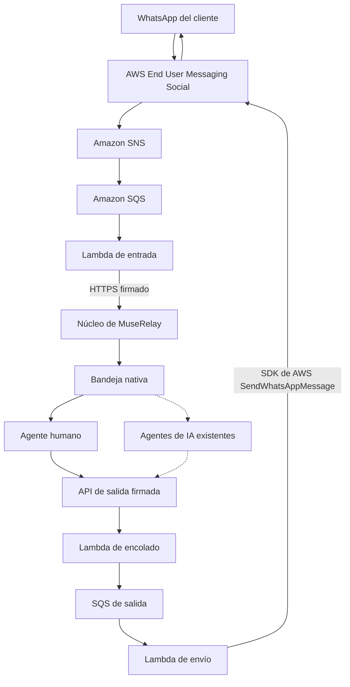

# MuseRelay AWS Engagement Bridge

**Atención al cliente por WhatsApp en tiempo real con AWS End User Messaging Social.**

Un transporte de WhatsApp nativo de AWS que lleva las conversaciones de los clientes a la bandeja unificada que MuseRelay ya tenía, permite responder a personas y deja el mismo canal preparado para la atención con IA.

**Plataforma SaaS en producción:** https://muserelay.com  
**Titular del proyecto y participante en el hackathon:** Screen Art S.L. (España)  
**AWS CDS Partner Hackathon · octubre de 2026**

*English version: [README.md](README.md)*

## El problema

Las empresas necesitan conectar sus conversaciones de WhatsApp con sus equipos de atención, agentes de IA y procesos de negocio sin mantener bandejas separadas ni guardar en su aplicación tokens de larga duración de la API de Meta.

MuseRelay AWS Engagement Bridge resuelve el transporte y la integración usando **AWS End User Messaging Social** para WhatsApp, sin cambiar la experiencia de atención que MuseRelay ya ofrece.

Los clientes escriben por WhatsApp y sus conversaciones aparecen en la misma bandeja nativa que usan los demás canales de MuseRelay.

## Qué hemos construido

El Bridge es una integración con AWS nueva, desarrollada de forma independiente durante el periodo del hackathon, desde el 24 de octubre de 2026.

Ofrece:

- **Recepción de WhatsApp nativa de AWS:** los eventos viajan por AWS End User Messaging Social, SNS, SQS y Lambda hasta MuseRelay.
- **Respuestas de personas a través de AWS:** los mensajes salientes se envían con el SDK oficial de AWS y `SendWhatsAppMessage`.
- **Integración con la bandeja nativa:** mensajes, contactos, conversaciones y estados de entrega usan el modelo de datos que MuseRelay ya tenía.
- **Comunicación firmada:** AWS Lambda y MuseRelay se comunican con mensajes HTTPS autenticados.
- **Procesamiento fiable:** idempotencia, protección contra duplicados, gestión de reintentos y estado persistente.
- **Aislamiento de canales:** cada número de WhatsApp está enlazado a la organización y al canal correctos de MuseRelay.

El Bridge funciona sobre infraestructura de AWS sin que los servidores de aplicación de MuseRelay ni su base de datos PostgreSQL tengan que estar en AWS.

## Arquitectura



*Las líneas continuas son el flujo de mensajería implementado. La IA está disponible en los agentes que MuseRelay ya tenía, pero todavía no se ha verificado de extremo a extremo a través de este Bridge.* Los estados de entregado y leído vuelven por el camino de entrada (SNS → SQS → Lambda de entrada) y actualizan el mensaje en la bandeja.

## Integración con el SDK de AWS

El SDK oficial de AWS para JavaScript se ejecuta **dentro de la Lambda de envío, en AWS**, no en el servidor de aplicación de MuseRelay.

La implementación usa:

```typescript
import {
  SocialMessagingClient,
  SendWhatsAppMessageCommand
} from "@aws-sdk/client-socialmessaging";

// Lambda de envío
const result = await client.send(
  new SendWhatsAppMessageCommand(payload)
);
```

**Código:** [src/social.ts](https://github.com/screenartsl/aws-engagement-bridge/blob/main/src/social.ts)

La Lambda usa su propio rol de ejecución IAM, con permiso para enviar WhatsApp solo desde el recurso de número de teléfono de AWS autorizado.

AWS End User Messaging Social se invoca en tiempo de ejecución: no solo está aprovisionado o referenciado en la infraestructura.

## Resultados verificados en vivo

El Bridge está desplegado y probado con un número de WhatsApp real y la organización de demostración de MuseRelay.

| Capacidad | Resultado |
|---|---|
| Texto de WhatsApp recibido a través de AWS | Verificado |
| Contacto y conversación creados en la bandeja nativa | Verificado |
| Respuesta de una persona enviada con `SendWhatsAppMessage` | Verificado |
| Estado «entregado» de WhatsApp | Verificado |
| Estado «leído» de WhatsApp | Verificado |
| Rechazo de firmas inválidas y de duplicados | Verificado |
| Respuesta generada por IA a través del Bridge | Pendiente de verificar en vivo |
| Acción de ticket o calendario con Bedrock | Pendiente de verificar en vivo |
| Plantillas de WhatsApp listadas y enviadas por AWS | Implementado; envío pendiente de verificar en vivo |
| Foto, nota de voz y PDF entrantes (`GetWhatsAppMessageMedia`) | Implementado; pendiente de verificar en vivo |
| Confirmaciones por email (Amazon SES) y SMS (End User Messaging SMS) | Implementado, sin desplegar ([detalles](docs/NOTIFY-SES-SMS.md)) |

Un mensaje saliente real fue aceptado por AWS y después marcado como leído en el móvil del destinatario.

**Evidencias e instrucciones para reproducirlo:** [docs/EVALUATION.md](https://github.com/screenartsl/aws-engagement-bridge/blob/main/docs/EVALUATION.md)

Limitaciones actuales: se ignoran vídeos, stickers y documentos que no sean PDF. Lo que no figura como «Verificado» no debe presentarse como una capacidad terminada.

## Seguridad y fiabilidad

- Roles de ejecución IAM separados para las Lambdas de entrada, encolado y envío.
- MuseRelay no guarda tokens de acceso de Meta para los canales que usan el transporte de AWS.
- El motor de mensajería en producción no necesita claves de acceso de AWS.
- Claves de firma HMAC independientes por enlace y por dirección de la comunicación.
- AWS Secrets Manager para los secretos del lado de AWS.
- Verificación de firmas, control de caducidad y protección contra repeticiones.
- Idempotencia y estado de procesamiento persistente en DynamoDB.
- Infraestructura de mensajería cifrada y contenido de los logs restringido.
- Sin alternativa por la API directa de Meta si falla el transporte de AWS.

Las credenciales administrativas de despliegue están separadas del motor de mensajería.

## Trabajo nuevo y plataforma existente

| Desarrollado para este hackathon | Capacidades que MuseRelay ya tenía |
|---|---|
| Módulo AWS Engagement Bridge | Aplicación SaaS y bandeja unificada |
| Infraestructura AWS SAM/CloudFormation | Organizaciones, espacios de trabajo y CRM |
| Lambdas de entrada, encolado y envío | Agentes de IA e integraciones con Bedrock |
| Envío de WhatsApp con el SDK oficial de AWS | Tickets, calendario y herramientas de negocio |
| Contrato de comunicación HTTPS firmado | Interfaces de atención al cliente |
| Conector nativo para el núcleo y parches de integración | Núcleo y modelos de base de datos |
| Sincronización de estados de WhatsApp a través de AWS | Componentes de presentación de mensajes |

El módulo Bridge presentado es obra original y propiedad de **Screen Art S.L.** Su comercialización podrá hacerla después una empresa vinculada con los mismos propietarios.

La plataforma MuseRelay que ya existía no se presenta como trabajo nuevo del hackathon.

Historial de desarrollo y procedencia: [docs/PROVENANCE.md](https://github.com/screenartsl/aws-engagement-bridge/blob/main/docs/PROVENANCE.md).

## Estructura del repositorio

| Ruta | Contenido |
|---|---|
| `src/` | Lambdas en TypeScript e integración con el SDK de AWS |
| `test/` | Tests automáticos |
| `template.yaml` | Plantilla AWS SAM/CloudFormation del entorno de ejecución |
| `integration/muserelay/` | Conector Laravel e integración con el núcleo |
| `deploy/` | Plantillas de despliegue y procedimientos revisados |
| `docs/EVALUATION.md` | Instrucciones para el jurado y evidencias en vivo |
| `docs/PROVENANCE.md` | Historial de desarrollo y titularidad |
| `docs/history/` | Revisiones archivadas de desarrollo e infraestructura |

## Compilar y probar

Requisitos: Node.js 22 y PHP 8.1+ para el conector.

```bash
npm ci --ignore-scripts
npm test
npm run bundle
```

Estos comandos compilan y prueban el módulo de Node.js en local, sin credenciales de AWS.

Las instrucciones de los tests del conector están en [docs/STAGING.md](https://github.com/screenartsl/aws-engagement-bridge/blob/main/docs/STAGING.md).

## Despliegue y evaluación

El despliegue verificado funciona en la región de AWS `eu-west-1`, integrado con el entorno de demostración de MuseRelay.

Requisitos previos, configuración de CloudFormation, claves de firma, enlace del canal y activación controlada:

- [Guía de despliegue](https://github.com/screenartsl/aws-engagement-bridge/blob/main/docs/CLOUDFORMATION-DEPLOYMENT.md)
- [Guía de evaluación](https://github.com/screenartsl/aws-engagement-bridge/blob/main/docs/EVALUATION.md)

El alta de clientes con su propia cuenta de AWS está prevista, pero todavía no está disponible en autoservicio.

## Hoja de ruta

- Verificar respuestas generadas por IA con Amazon Bedrock a través del transporte de WhatsApp por AWS.
- Demostrar una acción real de atención al cliente, como la creación de un ticket.
- Verificar en vivo la multimedia entrante y, cuando se autorice, las confirmaciones por email y SMS.
- Alta en autoservicio de cuentas de AWS propias del cliente y enlace de sus canales.

---

**Screen Art S.L. · AWS CDS Partner Hackathon 2026**  
**MuseRelay:** https://muserelay.com
