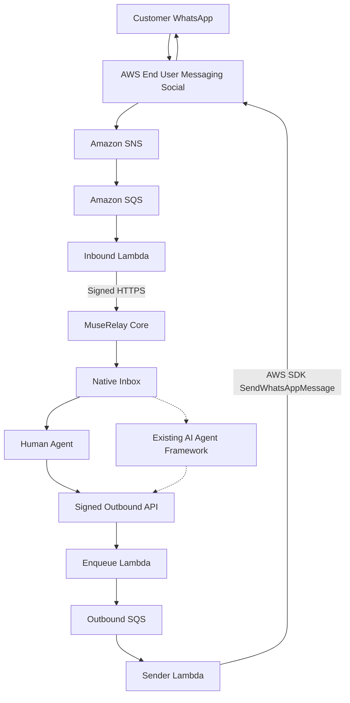

# MuseRelay AWS Engagement Bridge

**Real-time WhatsApp customer engagement powered by AWS End User Messaging Social.**

An AWS-native WhatsApp transport that connects customer conversations to MuseRelay's existing unified inbox, enabling human replies and preparing the same channel for AI-powered customer service.

**Live SaaS platform:** https://muserelay.com  
**Project owner and hackathon entrant:** Screen Art S.L. (Spain)  
**AWS CDS Partner Hackathon · October 2026**

*Versión en español: [README.es.md](README.es.md)*

## The problem

Businesses need to connect WhatsApp conversations to customer service teams, AI agents and business workflows without maintaining separate inboxes or embedding long-lived Meta API tokens in their application.

MuseRelay AWS Engagement Bridge solves the transport and integration problem by using **AWS End User Messaging Social** for WhatsApp messaging, while retaining MuseRelay's existing customer-service experience.

Customers can communicate through WhatsApp, and their conversations appear in the same native inbox used by MuseRelay's other channels.

## What we built

The Bridge is a new, independently developed AWS integration created during the hackathon submission period, beginning October 24, 2026.

It provides:

- **AWS-native WhatsApp reception:** events travel through AWS End User Messaging Social, SNS, SQS and Lambda into MuseRelay.
- **Human replies through AWS:** outbound messages are sent using the official AWS SDK and `SendWhatsAppMessage`.
- **Native inbox integration:** messages, contacts, conversations and delivery statuses use MuseRelay's existing data model.
- **Signed communication:** authenticated HTTPS messages connect AWS Lambda and MuseRelay.
- **Reliable processing:** idempotency, duplicate protection, retry handling and durable state.
- **Channel isolation:** bindings associate WhatsApp numbers with the correct MuseRelay organization and channel.

The Bridge runs on AWS infrastructure without requiring MuseRelay's application servers or PostgreSQL database to be hosted on AWS.

## Architecture



*Solid paths represent the implemented messaging flow. AI integration is available in MuseRelay's existing framework but has not yet been verified end to end through this Bridge.* Delivered and read statuses return along the inbound path (SNS → SQS → Inbound Lambda) and update the message in the inbox.

## AWS SDK integration

The official AWS SDK for JavaScript runs **inside the Sender Lambda on AWS**, not on the MuseRelay application server.

The implementation uses:

```typescript
import {
  SocialMessagingClient,
  SendWhatsAppMessageCommand
} from "@aws-sdk/client-socialmessaging";

// Sender Lambda
const result = await client.send(
  new SendWhatsAppMessageCommand(payload)
);
```

**Source:** [src/social.ts](https://github.com/screenartsl/aws-engagement-bridge/blob/main/src/social.ts)

The Lambda uses its dedicated IAM execution role, with permission to send WhatsApp messages through the authorized AWS phone-number resource.

AWS End User Messaging Social is invoked at runtime, not merely provisioned or referenced in the infrastructure.

## Verified live results

The Bridge has been deployed and tested using a real WhatsApp number and the existing MuseRelay demo organization.

| Capability | Result |
|---|---|
| WhatsApp text received through AWS | Verified |
| Contact and conversation created in the native inbox | Verified |
| Human reply sent using `SendWhatsAppMessage` | Verified |
| WhatsApp delivered status | Verified |
| WhatsApp read status | Verified |
| Invalid signature and duplicate rejection | Verified |
| AI-generated reply through the Bridge | Pending live verification |
| Ticket or calendar action through Bedrock | Pending live verification |
| WhatsApp templates listed and sent through AWS | Implemented; send pending live verification |
| Inbound photo, voice note and PDF (`GetWhatsAppMessageMedia`) | Implemented; pending live verification |
| Email (Amazon SES) and SMS (End User Messaging SMS) confirmations | Implemented, not deployed ([details](docs/NOTIFY-SES-SMS.md)) |

A real outbound message was accepted by AWS and subsequently marked as read on the recipient's handset.

**Evidence and reproduction instructions:** [docs/EVALUATION.md](https://github.com/screenartsl/aws-engagement-bridge/blob/main/docs/EVALUATION.md)

Current limitations: video, stickers and documents other than PDF are ignored. Rows not marked "Verified" must not be presented as completed capabilities.

## Security and reliability

- Separate IAM execution roles for inbound, enqueue and sender Lambdas.
- No Meta access tokens stored in MuseRelay for AWS transport channels.
- No AWS access keys required by the production messaging runtime.
- Independent HMAC signing keys per binding and communication direction.
- AWS Secrets Manager for AWS-side secrets.
- Signature verification, expiration checks and replay protection.
- DynamoDB-backed idempotency and durable processing state.
- Encrypted messaging infrastructure and restricted log contents.
- No direct Meta API fallback when AWS transport fails.

Administrative deployment credentials are separate from the messaging runtime.

## New work vs. existing platform

| Developed for this hackathon | Pre-existing MuseRelay capabilities |
|---|---|
| AWS Engagement Bridge module | SaaS application and unified inbox |
| AWS SAM/CloudFormation infrastructure | Organizations, workspaces and CRM |
| Inbound, enqueue and sender Lambda handlers | AI agent framework and Bedrock integrations |
| Official AWS SDK WhatsApp sender | Ticketing, calendar and business tools |
| Signed HTTPS communication contract | Existing customer-service interfaces |
| Native Core connector and integration patches | Existing Core and database models |
| WhatsApp status synchronization through AWS | Existing message presentation components |

The submitted Bridge module is original work owned by **Screen Art S.L.** Commercialization may subsequently be handled by a related company under common ownership.

The pre-existing MuseRelay platform is not represented as newly developed hackathon work.

Development history and provenance: [docs/PROVENANCE.md](https://github.com/screenartsl/aws-engagement-bridge/blob/main/docs/PROVENANCE.md).

## Repository structure

| Path | Purpose |
|---|---|
| `src/` | TypeScript Lambda handlers and AWS SDK integration |
| `test/` | Automated tests |
| `template.yaml` | AWS SAM/CloudFormation runtime template |
| `integration/muserelay/` | Laravel connector and Core integration |
| `deploy/` | Deployment templates and reviewed procedures |
| `docs/EVALUATION.md` | Judge instructions and live evidence |
| `docs/PROVENANCE.md` | Development history and ownership |
| `docs/history/` | Archived development and infrastructure reviews |

## Build and test

Requirements: Node.js 22 and PHP 8.1+ for the connector.

```bash
npm ci --ignore-scripts
npm test
npm run bundle
```

These commands build and test the Node.js module locally without requiring AWS credentials.

Connector test instructions are documented in [docs/STAGING.md](https://github.com/screenartsl/aws-engagement-bridge/blob/main/docs/STAGING.md).

## Deployment and evaluation

The verified deployment runs in AWS region `eu-west-1`, integrated with the MuseRelay demo environment.

For deployment prerequisites, CloudFormation configuration, signing keys, channel binding and controlled activation, see:

- [Deployment guide](https://github.com/screenartsl/aws-engagement-bridge/blob/main/docs/CLOUDFORMATION-DEPLOYMENT.md)
- [Evaluation guide](https://github.com/screenartsl/aws-engagement-bridge/blob/main/docs/EVALUATION.md)

A new customer's independent AWS account onboarding is planned, but is not yet available as a self-service feature.

## Roadmap

- Verify AI-generated replies through the AWS WhatsApp transport using Amazon Bedrock.
- Demonstrate a real customer-service tool action, such as ticket creation.
- Verify inbound media and, once authorized, email/SMS confirmations end to end.
- Introduce self-service AWS account onboarding and channel binding for customer-owned AWS accounts.

---

**Screen Art S.L. · AWS CDS Partner Hackathon 2026**  
**MuseRelay:** https://muserelay.com
