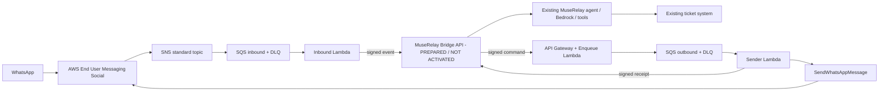

# MuseRelay AWS Engagement Bridge

Permanent MuseRelay AWS transport extension under development for Screen Art S.L.; its first milestone is a real AWS CDS Agentic AI Partner Hackathon demonstration.
Created on 2026-10-24. This repository contains new bridge code, not a copy of the proprietary MuseRelay application.

Local development location: `/var/www/vhosts/muserelay.com/modules-develop/aws-engagement-bridge` (moved from `.codex/projects/` on 2026-10-24 at the user's request). See the parent `modules-develop/README.md` and `AGENTS.md` for discovery and working rules. This is not an installed extension loader: MuseRelay does not automatically load code from this directory. The existing lsyncd scope includes this location; file replication is not deployment or activation.

## Receive-first preparation (2026-10-25)

**HOLD, 2026-10-26:** the owner reports the runtime change-set creation FAILED / UNAVAILABLE because the execution role lacks authorization for the AWS SAM transform. No retry or additional IAM change is authorized. [Exact one-statement IAM proposal, complete diff and native CloudFormation alternative](docs/SAM-TRANSFORM-REVIEW-2026-10-26.md). The uploaded ZIP, existing roles/ingress and production Core remain unchanged; do not repeat earlier create-change-set instructions until this proposal is reviewed.

Quota correction prepared locally: the owner reports Lambda total/unreserved concurrency 10, functions 0 in Ireland. The earlier receive template SHA256 `3e82e39dd7aa...` and its review request must NOT be deployed: they reserve one function execution. The revised inbound uses unreserved capacity and a maximum of two concurrent invocations from its SQS mapping, still disabled. The previous private draft release is marked SUPERSEDED. No quota increase or AWS change is performed; the current pinned review artifacts are in deploy/runtime-review/.

Development connector **0.5.1 is prepared, not installed**; production remains the disabled 0.4.0 connector. Reception, agent and send are separate opt-ins, all false by default. A dormant, organization-scoped activation can validate installation before connecting a binding or signing key; it is not connected messaging. Receiving still requires its own control, binding and authentication. The receive-first runtime does not create outbound infrastructure. IAM roles now belong to a separately reviewed foundation update; the limited runtime executor cannot rewrite IAM. The [native inbox staging](docs/NATIVE-INBOX-STAGING.md) reuses the actual Core views/controllers in an isolated copy; final judges access is planned in existing MuseRelay under an owner-created demo account, not a second inbox. See [current delivery and controls](docs/RECEIVE-FIRST-DELIVERY.md) and [current IAM/runtime review](deploy/runtime-iam/README.md). These documents supersede older all-in-one runtime/secret/activation instructions below. No local change constitutes an AWS deployment or activation. Inbound/sender use only the Core-direction signing secret; the future outbound enqueuer uses a separate outbound-direction secret.

Next console step: [pinned IAM UPDATE, exact expected resources and copyable GPT prompt](docs/CONSOLE-IAM-RUNTIME-REVIEW-2026-10-25.md). Use `deploy/runtime-iam/template.yaml`, GrantSocialSend=false, and review the change set without executing. [Final 0.5.1 local validation](docs/RELEASE-0.5.1-REVIEW.md) distinguishes isolated tests from live AWS operation.

Latest operator update: IAM Foundation is reported UPDATE_COMPLETE and its three runtime inline policies verified. Next is the [disabled receive-runtime UPDATE review](deploy/runtime-review/README.md), with a pinned local ZIP, complete parameter set and five expected additions. No runtime change set has been created by this server; ZIP upload, AWS execution and Core activation remain separately authorized steps. Earlier IAM preparation documents record the historical review.

Subsequent owner evidence: the specifically authorized runtime ZIP upload is reported complete in the intended S3 key, 274324 bytes, matching SHA256 and AES256, without overwrite; expiry is reported 2026-11-25 under ExpireDemoArtifacts. [Evidence and provenance](deploy/runtime-review/evidence.s3-upload.owner-reported.json). No runtime deployment/activation or Core installation is authorized by that upload; the next step remains creating and reviewing the disabled-runtime change set.

## Current status — Core connector DISABLED; Social linked; ingress inspection prepared

Current AWS update (2026-10-25): the user reports the dedicated demo WABA/phone linked and active, the staging SNS destination enabled, and two visible inbound SQS items with zero DLQ/inflight/delayed counts. Earlier CloudShell configuration checks were reported consistent. These are user-supplied snapshots, not direct AWS calls or proof of user-message contents. A [controlled, redacted sample inspection](docs/INBOUND-SAMPLE-INSPECTION.md) is prepared and tested locally; it has not been executed. ReceiveMessage would increment receive counts and temporarily hide up to two items for 30 seconds, so execution needs separate authorization. No Core/runtime/worker/agent/send activation was performed. The metadata collector remains strictly read-only.

Following the user's separate authorization, the trusted module loader and PHP release are installed in the existing MuseRelay Core. Runtime state is **disabled, zero authorized organizations, zero AWS channels and five empty Bridge tables**. No AWS resources, real messages or paid model calls were created by this work. See the [post-install verification and exact commits](docs/POST-INSTALL-VERIFICATION.md), [rollback procedure](docs/CORE-ROLLBACK.md) and [module architecture](docs/CORE-EXTENSIONS.md). Earlier phase reports describe their historical state.

The user subsequently reported IAM Foundation and the ingress stack deployed, with demo phone association, SNS publication and queue counters verified in CloudShell. Those user-reported checks supersede earlier pending-registration notes. The next step is an UPDATE of the existing IAM foundation, not a new SNS topic, WABA or phone. Live processing into MuseRelay and the full conversation remain unverified. See the [WhatsApp onboarding guide and evidence log](docs/AWS-WHATSAPP-ONBOARDING.md) and [prepared SNS/SQS bootstrap](deploy/sns-bootstrap/README.md). Commercial managed-AWS onboarding and partner BYO AWS are future designs, not implemented capabilities.

The AWS transport currently supports text and selected delivery states, and deliberately ignores inbound media. Media retrieval/storage is not implemented. A larger SNS payload limit does not add that support; see [media and payload limits](docs/MEDIA-AND-PAYLOAD-LIMITS.md).

Future product ideas are recorded in [Connect and personal/business/hybrid deployment concepts](docs/FUTURE-HYBRID-ARCHITECTURE.md). Desktop, Mobile, offline synchronization, private hosting and BYO AWS remain proposals, outside the first live demonstration; no new functionality is implemented by that document.

[KMS costs and AWS access](docs/AWS-ACCESS-AND-KMS-COSTS.md) separates key storage, billable operations and messaging costs, and records the pending non-root execution identity/MFA checks. It does not configure access or authorize deployment.

Implemented locally: official AWS Social Messaging SDK adapter, text/status event normalization, explicitly scoped channel bindings, HMAC transport, DynamoDB idempotency/leases/nonces/demo budgets, SQS handlers, isolated infrastructure template and PHP/Node signature interoperability.

Phase 2 adds the Laravel package under `integration/muserelay/`: authenticated controllers, opt-in organization/channel binding, encrypted durable inbox/outbox, worker, native agent/inbox adapter and transactional ticket-action checkpoint. The three Core changes are maintained in `core-hooks.patch`; trusted module support is in `core-extension-support.patch`. Release 0.4.0 includes the authorized, disabled Core installation. See `docs/PHASE-2.md` and `docs/STAGING.md` for the original phase scope and test limitations.

Phase 3 adds a reproducible Linux staging harness with its own PostgreSQL/Redis instances, Composer installation, real Laravel workers and native agent/ticket execution against controlled AWS SDK transports. The conformance suite also runs on PostgreSQL, including concurrent acceptance and leases. See [phase 3 evidence](docs/PHASE-3.md), [staging runbook](docs/STAGING.md) and [exact live AWS prerequisites](docs/AWS-LIVE-CHECKLIST.md).

Phase 4 prepares the first live run for Screen Art account `365470560685`, Ireland: disabled parameters, targeted read-only preflight, a separate HTTPS staging harness, metadata-only AWS evidence, acceptance verifier and deployment/removal runbook. No live resources or services have been activated. The non-root IAM profile, verified AWS-linked identifiers and final staging node remain pending; the user has since reported completing the Meta portion for a dedicated demo number. See [phase 4 decision and costs](docs/PHASE-4.md) and [activation/removal runbook](docs/PHASE-4-RUNBOOK.md). Calendars and throughput for thousands of users are not implemented/validated in this phase.

The permanent architecture is an opt-in extension inside the existing MuseRelay application, sharing its panels/domains, organizations, agents, native inbox/tools and database/Redis services. The separate phase 4 copy and technical hostname are temporary test infrastructure; they do not impose a second commercial installation or separate infrastructure per future module. The current Core installation was separately authorized; future production changes and shared-service reloads require authorization.

**No real WhatsApp sends, AWS resource creation or live Bedrock invocation.** Native ticket tests run only against disposable synthetic databases. Billing and AWS services are simulated. Post-install checks additionally restored the full database backup into private PostgreSQL, compared the historical schema, rendered authenticated panels using a separate empty schema with synthetic users, and checked the actual HTTPS ingress without production login. These are server-render and integration checks, not a browser/JavaScript or live-provider certification. Existing reseller settings, native tools and production channels were preserved.

On 2026-10-25 (Europe/Paris), the user explicitly authorized creating and uploading [screenartsl/aws-engagement-bridge](https://github.com/screenartsl/aws-engagement-bridge) as a **private** repository. GitHub authenticated the `screenartsl` identity and confirmed private ownership/visibility. The complete phase 4 branch is the source for `main`; original phase branches and commit history are preserved. Repository publication does not install the connector, deploy AWS, activate staging, send messages or authorize public/judge access. See [repository publication](docs/REPOSITORY-UPLOAD.md).

## Architecture



`src/social.ts` calls `SocialMessagingClient.send(new SendWhatsAppMessageCommand(...))`. It uses Lambda's IAM role, never a Meta access token. SDK automatic retries for sends are disabled. API acceptance is not delivery: status events must update the Core message independently.

## Local checks — no production application bootstrap

Requirements: Node 22 recommended (local development also tested on Node 20), npm, PHP 8.1+ for the interoperability tests. No database, Redis, `.env`, AWS account or credentials needed for the tests.

```sh
npm ci --ignore-scripts
npm test
npm run bundle
```

Tests use synthetic identities and an in-process SDK HTTP transport. They do not contact AWS or Meta and do not run MuseRelay's artisan/phpunit bootstrap. DynamoDB tests mock the document transport; persistence behavior in real DynamoDB still requires an authorized staging test.

For the additional PHP connector tests, use `integration/muserelay/phpunit.xml` with the explicit dependency/source variables documented in `docs/STAGING.md`. They build **SQLite in-memory fixtures by default**, or a guarded private PostgreSQL test database under the staging runner, never load production `.env` or `bootstrap/app.php`, and include live-class regression checks for the existing Meta/Telnyx configuration branches. The separate staging suite exercises native models, workers and agent/tool execution.

`package-lock.json` pins the resolved dependencies. Runtime artifacts are produced in `build/`; they are not committed. The SAM template uses Node 22 arm64. Inbound uses unreserved capacity and an SQS mapping maximum concurrency of two; its mapping stays disabled until authorized. Deferred outbound functions retain their separate reservation requirement and are not selected for receive-only deployment.

## Configuration and secrets

See `examples/bindings.example.json` and `.env.example`. The module does not automatically load any `.env` file. Each binding maps an exact SNS topic, WABA, Meta phone id and AWS phone ARN to one opaque MuseRelay channel reference. Organization/workspace/agent ownership is resolved and enforced by Core, never chosen by the incoming body. Use one dedicated demo identity and synthetic organization.

Two independent HMAC keys of at least 32 bytes per binding are required in a **dedicated Secrets Manager secret**. The runtime template can create an empty secret for private initialization; an approved existing dedicated secret is optional. Its JSON structure is `{ "binding-id": { "core": "...", "outbound": "..." } }`. Generate keys outside source control. Never reuse the production `APP_KEY`, Meta tokens or reseller SMTP credentials. On the Core host, the package reads corresponding keys only from a permission-protected file under `/run/secrets/` or `/etc/muserelay/aws-bridge/`, outside replicated vhosts. Config cache stores only its path. No such live file has been created. The Lambda keys are cached for at most 60 seconds by each warm function. IAM limits access to the provided secret ARN. Customer-managed KMS encryption for this secret additionally needs a scoped `kms:Decrypt` grant; the current template assumes the default Secrets Manager key.

The first deployment must use `enabled:false` and `LiveSend=false`. Allowed recipients default to an empty array. The live-send flag alone cannot bypass a disabled binding or the recipient allowlist.

## Provisioning — requires separate authorization

The current [ingress change-set review](docs/SNS-BOOTSTRAP-CHANGE-SET.md) supersedes pending IAM deployment statements below. The subsequent [effective-permission review](docs/IAM-FOUNDATION-VERIFICATION.md) removes unnecessary executor key-destruction permissions and records the actual AWS verification still pending. A recovery-role STS test happens after the IAM-only stack and before any KMS key; local validation is not proof of live access.

The later [SSO/KMS administration review](docs/AWS-KMS-ADMINISTRATION.md) supersedes the earlier sole-administrator design. Use the revised templates with two stable IAM roles, a CloudFormation service role and limited account recovery. The old release YAML must not be deployed. The user reports Identity Center/MFA ready; no authenticated AWS verification or new role creation has been performed here.

Use the authoritative [two-stage encrypted CloudFormation runbook](docs/CLOUDFORMATION-DEPLOYMENT.md). No deployment, AWS changes or activation is authorized by preparing these files.

1. Read-only preflight: confirm non-root execution identity, Screen Art account `365470560685`, `eu-west-1`, permissions/SCP/quotas and existing resources. `KmsAdministratorArn` is still required; do not invent it.
2. After approval, create stack **`muserelay-aws-bridge-stage`** with [encrypted ingress template](deploy/sns-bootstrap/template.yaml): 12 resources including SNS Standard, dedicated KMS key/alias, inbound SQS plus processing and delivery DLQs, resource policies/subscription and private S3 artifact bucket. No Lambda/roles/secret/Core deployment in stage 1.
3. Verify `InboundTopicArn` from real outputs and SNS before copying it to the WhatsApp form. WABA event-destination changes need separate approval. The existing reported demo number is the intended asset; no new number is required by the two-stage architecture. AWS/Meta may require resuming an expired signup session.
4. Prepare the reviewed local ZIP with `scripts/cloudformation/package-runtime.py` and, after approval, upload to the private bucket/key in its manifest. Update **the same stack** using `template.yaml` and final AWS/Meta identifiers, `DeployProcessing=true`, `ProcessingEnabled=false`, `LiveSend=false`, disabled bindings and empty recipient allowlist. Do not replace the original ingress. The CodeUri already references S3 bucket/key; the old `sam package` instructions in historical phase reports do not apply.
5. Initialize signing keys privately, verify isolated Core staging/Bedrock and only then request specific authorization for demo processing and real messages. Production remains off. The stack does not register WhatsApp, deploy the Core or create Bedrock agents/identity.

The complete SAM expansion has **30 CloudFormation resources** when it creates a new empty secret: one SNS topic/policy/subscription, dedicated key/alias, five SQS queues (two main + three DLQs) and two queue policies, a private S3 bucket/policy, DynamoDB state table, three Lambda functions/roles/log groups, two event mappings, one Lambda/API permission, HTTP API/stage and signing secret. Key, bucket, table and owned secret use Retain: deletion is a separately reviewed procedure, and ongoing costs can remain.

Only the sender role receives `social-messaging:SendWhatsAppMessage`, scoped to the selected phone ARN. Runtime roles cannot administer IAM/KMS, register WABA or invoke Bedrock. SNS publication and KMS usage are restricted to Social in the stack account/region; SQS publication is restricted to the topic. `/outbound` requires application HMAC verification before enqueueing and rejects operations while the runtime is off. API requests may still have cost even when rejected.

The first-stage template can be uploaded via console; doing so may create/upload a CloudFormation template S3 object/bucket before stack creation and therefore also requires approval. The runtime additionally needs the separately packaged ZIP in S3. No AWS CLI/SAM CLI is required for this console path. All validation so far is offline; AWS service-side permission and compatibility checks remain pending.

## Delivery semantics and limits

- Duplicates use the provider message id, not the SNS notification id. Core must independently persist the same idempotency key before acknowledging an event.
- Inbound leases can be reclaimed after 180 seconds. Outbound leases cannot: a dead sender might already have sent the message. Expired outbound leases become `uncertain` for manual reconciliation.
- Outbound payload changes under the same command id are rejected. After AWS accepts a command, a receipt callback retry cannot resend it.
- Known throttle rejections can retry via SQS; unknown provider failures are uncertain. Do not manually redrive an uncertain command under a new id without checking it.
- The reviewed CloudFormation template sets at most 6 inbound demo message attempts and 6 outbound send attempts per binding per UTC day (default 6/6). Standalone library defaults are not a substitute for these deployment parameters. Retries may consume extra budget. These are demo controls, not a complete SaaS billing system or hard limit on every AWS infrastructure cost.
- Status messages do not invoke the agent. Text only; media and other notifications do not generate automatic replies. Events for unallowlisted users are ignored in this restricted demo.
- State hashes/identifiers expire after 30 days. Replays after the retention period require the independent Core deduplication policy. Queue payloads contain customer text and require restricted administration; application logs intentionally omit it.
- Ordering across standard SNS/SQS messages is not guaranteed. Core must serialize turns per conversation and deal with late status transitions. Do not claim this is already implemented here.
- The existing agent/tool engine and its historical failover/idempotency limitations remain pre-existing dependencies. Transport deduplication alone does not make ticket/tool execution exactly once.

## Real end-to-end acceptance — pending authorization/resources

Use an approved demo organization, ticket inbox, agent with Bedrock configured and cultural activity knowledge. Ask about an activity and request registration. The agent must explicitly create a **request/ticket**, not claim a confirmed seat or booking. Follow the existing tool's confirmation and required-contact rules.

Evidence must correlate: inbound WhatsApp provider id → SNS event → Core conversation/message → actual Bedrock provider/model → `support_create_ticket` call → persisted ticket/audit → outbound command → SDK message id → handset delivery/read event. Use synthetic content in captures.

Also test invalid HMAC, replay, cross-binding requests, duplicate SNS events, repeated commands, Core outage, explicit throttling, sender crash and uncertain sends. Demonstrate deployment in a clean test stack. Mocks are local test evidence only.

## Originality, judging and repository access

See `docs/PROVENANCE.md`. The requested destination is **private `screenartsl/aws-engagement-bridge`**. The later user authorization and private publication recorded above supersede the phase 3 publication hold. No public release or judge invitation is authorized. `docs/REPOSITORY-UPLOAD.md` describes review and later authorized upload while preserving original commits. Provide authorized judges the bridge source and a working isolated MuseRelay evaluation instance; do not publish the entire legacy SaaS. A simulator cannot replace final live acceptance.

README, diagram, setup, limits, source versions, test instructions, video script and required APN/ACE submission details should accompany the final submission. See `docs/DEMO.md`. BYO AWS/STS, SES, UI onboarding and Marketplace are not implemented or claimed by this phase.

## Removal after authorized testing

Disable live sends and bindings first; coordinate removing the WABA event destination, then remove the reviewed stack. DynamoDB is retained intentionally to preserve uncertain-send evidence. Inspect and remove retained data and the external signing secret only after the retention/review decision. Never use this procedure on the production WABA.
