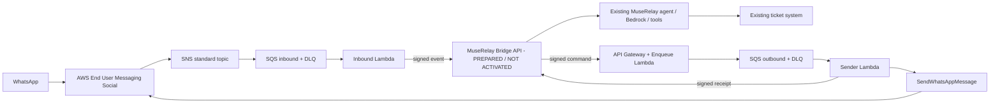

# MuseRelay AWS Engagement Bridge

Private development module for Screen Art S.L.'s AWS CDS Agentic AI Partner Hackathon project.
Created on 2026-10-24. This repository contains new bridge code, not a copy of the proprietary MuseRelay application.

Local development location: `/var/www/vhosts/muserelay.com/modules-develop/aws-engagement-bridge` (moved from `.codex/projects/` on 2026-10-24 at the user's request). See the parent `modules-develop/README.md` and `AGENTS.md` for discovery and working rules. This is not an installed extension loader: MuseRelay does not automatically load code from this directory. The existing lsyncd scope includes this location; file replication is not deployment or activation.

## Current status — Core connector 0.4.0 installed and DISABLED; AWS not deployed

Following the user's separate authorization, the trusted module loader and PHP release are installed in the existing MuseRelay Core. Runtime state is **disabled, zero authorized organizations, zero AWS channels and five empty Bridge tables**. No AWS resources, real messages or paid model calls were created by this work. See the [post-install verification and exact commits](docs/POST-INSTALL-VERIFICATION.md), [rollback procedure](docs/CORE-ROLLBACK.md) and [module architecture](docs/CORE-EXTENSIONS.md). Earlier phase reports describe their historical state.

Implemented locally: official AWS Social Messaging SDK adapter, text/status event normalization, explicitly scoped channel bindings, HMAC transport, DynamoDB idempotency/leases/nonces/demo budgets, SQS handlers, isolated infrastructure template and PHP/Node signature interoperability.

Phase 2 adds the Laravel package under `integration/muserelay/`: authenticated controllers, opt-in organization/channel binding, encrypted durable inbox/outbox, worker, native agent/inbox adapter and transactional ticket-action checkpoint. The three Core changes are maintained in `core-hooks.patch`; trusted module support is in `core-extension-support.patch`. Release 0.4.0 includes the authorized, disabled Core installation. See `docs/PHASE-2.md` and `docs/STAGING.md` for the original phase scope and test limitations.

Phase 3 adds a reproducible Linux staging harness with its own PostgreSQL/Redis instances, Composer installation, real Laravel workers and native agent/ticket execution against controlled AWS SDK transports. The conformance suite also runs on PostgreSQL, including concurrent acceptance and leases. See [phase 3 evidence](docs/PHASE-3.md), [staging runbook](docs/STAGING.md) and [exact live AWS prerequisites](docs/AWS-LIVE-CHECKLIST.md).

Phase 4 prepares the first live run for Screen Art account `365470560685`, Ireland: disabled parameters, targeted read-only preflight, a separate HTTPS staging harness, metadata-only AWS evidence, acceptance verifier and deployment/removal runbook. No live resources or services have been activated. The non-root IAM profile, independent demo WABA/number and final staging node remain pending. See [phase 4 decision and costs](docs/PHASE-4.md) and [activation/removal runbook](docs/PHASE-4-RUNBOOK.md). Calendars and throughput for thousands of users are not implemented/validated in this phase.

The permanent architecture is an opt-in extension inside the existing MuseRelay application, sharing its panels/domains, organizations, agents, native inbox/tools and database/Redis services. The separate phase 4 copy and technical hostname are temporary test infrastructure; they do not impose a second commercial installation or separate infrastructure per future module. The current Core installation was separately authorized; future production changes and shared-service reloads require authorization.

**No real WhatsApp sends, AWS resource creation or live Bedrock invocation.** Native ticket tests run only against disposable synthetic databases. Billing and AWS services are simulated. Post-install checks additionally restored the full database backup into private PostgreSQL, compared the historical schema, rendered authenticated panels using a separate empty schema with synthetic users, and checked the actual HTTPS ingress without production login. These are server-render and integration checks, not a browser/JavaScript or live-provider certification. Existing reseller settings, native tools and production channels were preserved.

On 2026-10-25 (Europe/Paris), the user explicitly authorized creating and uploading [screenartsl/aws-engagement-bridge](https://github.com/screenartsl/aws-engagement-bridge) as a **private** repository. GitHub authenticated the `screenartsl` identity and confirmed private ownership/visibility. The complete phase 4 branch is the source for `main`; original phase branches and commit history are preserved. Repository publication does not install the connector, deploy AWS, activate staging, send messages or authorize public/judge access. See [repository publication](docs/REPOSITORY-UPLOAD.md).

## Architecture



`src/social.ts` calls `SocialMessagingClient.send(new SendWhatsAppMessageCommand(...))`. It uses Lambda's IAM role, never a Meta access token. SDK automatic retries for sends are disabled. API acceptance is not delivery: status events must update the Core message independently.

## Local checks — no production application bootstrap

Requirements: Node 22 recommended (local development also tested on Node 20), npm, PHP 8.1+ for the interoperability tests. No database, Redis, `.env`, AWS account or credentials needed for the tests.

```sh
npm ci --ignore-scripts
npm test
npm run bundle
```

Tests use synthetic identities and an in-process SDK HTTP transport. They do not contact AWS or Meta and do not run MuseRelay's artisan/phpunit bootstrap. DynamoDB tests mock the document transport; persistence behavior in real DynamoDB still requires an authorized staging test.

For the additional PHP connector tests, use `integration/muserelay/phpunit.xml` with the explicit dependency/source variables documented in `docs/STAGING.md`. They build **SQLite in-memory fixtures by default**, or a guarded private PostgreSQL test database under the staging runner, never load production `.env` or `bootstrap/app.php`, and include live-class regression checks for the existing Meta/Telnyx configuration branches. The separate staging suite exercises native models, workers and agent/tool execution.

`package-lock.json` pins the resolved dependencies. Runtime artifacts are produced in `build/`; they are not committed. The SAM template deploys Node 22 arm64 functions with one reserved execution each.

## Configuration and secrets

See `examples/bindings.example.json` and `.env.example`. The module does not automatically load any `.env` file. Each binding maps an exact SNS topic, WABA, Meta phone id and AWS phone ARN to one opaque MuseRelay channel reference. Organization/workspace/agent ownership is resolved and enforced by Core, never chosen by the incoming body. Use one dedicated demo identity and synthetic organization.

Two independent HMAC keys of at least 32 bytes per binding are required in an **existing Secrets Manager secret**. Its JSON structure is `{ "binding-id": { "core": "...", "outbound": "..." } }`. Generate keys outside source control. Never reuse the production `APP_KEY`, Meta tokens or reseller SMTP credentials. On the Core host, the package reads corresponding keys only from a permission-protected file under `/run/secrets/` or `/etc/muserelay/aws-bridge/`, outside replicated vhosts. Config cache stores only its path. No such live file has been created. The Lambda keys are cached for at most 60 seconds by each warm function. IAM limits access to the provided secret ARN. Customer-managed KMS encryption for this secret additionally needs a scoped `kms:Decrypt` grant; the current template assumes the default Secrets Manager key.

The first deployment must use `enabled:false` and `LiveSend=false`. Allowed recipients default to an empty array. The live-send flag alone cannot bypass a disabled binding or the recipient allowlist.

## Provisioning — requires separate authorization

Do not deploy to the production hosting server. Use a reviewed AWS account and region `eu-west-1`, after confirming current Social/Meta version and number eligibility.

1. Review the prepared Core connector and `docs/CORE-INTEGRATION.md`, with its feature flag off. Follow `docs/STAGING.md` and test in an isolated application/database first. Installation, migrations and activation need separate authorization.
2. Resolve WABA linkage separately using a new non-production number. Obtain the WABA id, Meta phone id and **AWS phone ARN**; they are different identifiers.
3. Prepare the signing secret. Build with `npm ci --ignore-scripts && npm run bundle`.
4. Review `template.yaml`. Plan the topic ARN as `arn:aws:sns:eu-west-1:ACCOUNT:STACK-inbound`, matching `BindingsJson`. Use a dedicated stack name.
5. After approval, deploy the template using SAM/CloudFormation and the documented parameters. No deploy command is run by npm scripts. IAM resource creation requires acknowledgment.
6. After approval, associate the resulting SNS topic as the WABA event destination. This is a separate configuration action, not automated here. Avoid replacing the destination on a production WABA.
7. Set the Core API integration, verify signatures and receipts, and only then enable the demo binding and live sends for approved test recipients.

Resources: SNS topic and policy; two queues and two DLQs; DynamoDB state table; three Lambda functions with scoped roles; HTTP API; three seven-day log groups. The SNS topic currently uses service-default storage encryption behavior without a customer-managed key; SQS and DynamoDB specify encryption. If SNS KMS encryption is required, add a customer-managed key and the Social publisher grants first, not `alias/aws/sns` without verification.

IAM: only the sender role receives `social-messaging:SendWhatsAppMessage`, scoped to the provided phone ARN. The ingress role cannot send WhatsApp. SNS publication is restricted to Social in the stack account. Queue publication is restricted to the topic. No WABA-registration or IAM-management permissions are granted to runtime functions. API `/outbound` is publicly reachable only after an authorized deployment; every request must pass application HMAC verification before enqueueing. No CORS or unauthenticated send path is provided.

## Delivery semantics and limits

- Duplicates use the provider message id, not the SNS notification id. Core must independently persist the same idempotency key before acknowledging an event.
- Inbound leases can be reclaimed after 180 seconds. Outbound leases cannot: a dead sender might already have sent the message. Expired outbound leases become `uncertain` for manual reconciliation.
- Outbound payload changes under the same command id are rejected. After AWS accepts a command, a receipt callback retry cannot resend it.
- Known throttle rejections can retry via SQS; unknown provider failures are uncertain. Do not manually redrive an uncertain command under a new id without checking it.
- Default budgets are 40 inbound demo message attempts and 20 outbound send attempts per binding per UTC day, configurable up to 100. Retries may consume extra budget. These are demo controls, not a complete SaaS billing system or hard limit on every AWS infrastructure cost.
- Status messages do not invoke the agent. Text only; media and other notifications do not generate automatic replies. Events for unallowlisted users are ignored in this restricted demo.
- State hashes/identifiers expire after 30 days. Replays after the retention period require the independent Core deduplication policy. Queue payloads contain customer text and require restricted administration; application logs intentionally omit it.
- Ordering across standard SNS/SQS messages is not guaranteed. Core must serialize turns per conversation and deal with late status transitions. Do not claim this is already implemented here.
- The existing agent/tool engine and its historical failover/idempotency limitations remain pre-existing dependencies. Transport deduplication alone does not make ticket/tool execution exactly once.

## Real end-to-end acceptance — pending authorization/resources

Use an approved demo organization, ticket inbox, agent with Bedrock configured and cultural activity knowledge. Ask about an activity and request registration. The agent must explicitly create a **request/ticket**, not claim a confirmed seat or booking. Follow the existing tool's confirmation and required-contact rules.

Evidence must correlate: inbound WhatsApp provider id → SNS event → Core conversation/message → actual Bedrock provider/model → `support_create_ticket` call → persisted ticket/audit → outbound command → SDK message id → handset delivery/read event. Use synthetic content in captures.

Also test invalid HMAC, replay, cross-binding requests, duplicate SNS events, repeated commands, Core outage, explicit throttling, sender crash and uncertain sends. Demonstrate deployment in a clean test stack. Mocks are local test evidence only.

## Originality, judging and repository access

See `docs/PROVENANCE.md`. The requested destination is **private `screenartsl/aws-engagement-bridge`**. A local origin is configured, but its remote existence/privacy have not been authenticated here. The latest phase 3 instruction puts publication on hold pending specific authorization. No creation, push or judge invitation was performed in this phase. `docs/REPOSITORY-UPLOAD.md` describes review and later authorized upload while preserving original commits. Provide authorized judges the bridge source and a working isolated MuseRelay evaluation instance; do not publish the entire legacy SaaS. A simulator cannot replace final live acceptance.

README, diagram, setup, limits, source versions, test instructions, video script and required APN/ACE submission details should accompany the final submission. See `docs/DEMO.md`. BYO AWS/STS, SES, UI onboarding and Marketplace are not implemented or claimed by this phase.

## Removal after authorized testing

Disable live sends and bindings first; coordinate removing the WABA event destination, then remove the reviewed stack. DynamoDB is retained intentionally to preserve uncertain-send evidence. Inspect and remove retained data and the external signing secret only after the retention/review decision. Never use this procedure on the production WABA.
