# MuseRelay AWS Engagement Bridge

WhatsApp for the MuseRelay customer-service platform, carried end to end by **AWS End User Messaging Social**. Conversations land in MuseRelay's native inbox, where a person or an AI agent replies; the reply goes back to WhatsApp through the official AWS SDK (`SendWhatsAppMessage`). MuseRelay never holds a Meta access token for these channels.

**Owner:** Screen Art S.L. (Spain). This module is the original work of Screen Art S.L., created from 2026-10-24 for the AWS CDS Partner Hackathon. Commercialization may be handled by a related company under common ownership.

## What is new and what already existed

| New in this repository (from 2026-10-24) | Pre-existing (MuseRelay, not in this repository) |
| --- | --- |
| AWS infrastructure template (SNS, SQS, Lambda, API Gateway, DynamoDB, KMS, Secrets Manager) | Unified inbox, organizations and workspaces |
| Lambda handlers: inbound, enqueue, sender (`src/`) | AI agents, Bedrock integration and their tools (tickets, calendar, leads) |
| `SendWhatsAppMessage` adapter on the official SDK (`src/social.ts`) | Ticket system, CRM, reseller panel |
| Signed AWS ⇄ MuseRelay contract (HMAC, idempotency, leases) | |
| MuseRelay connector package (`integration/muserelay/`) and Core hook patches | |

Git history keeps every original commit and date: `git log --all --format='%h %cI %s'`. More detail in [docs/PROVENANCE.md](docs/PROVENANCE.md).

## Message flow

```mermaid
flowchart LR
  U[WhatsApp user] --> S[AWS End User Messaging Social]
  S --> T[SNS topic, KMS-encrypted]
  T --> IQ[SQS inbound + DLQ]
  IQ --> IL[Inbound Lambda]
  IL -->|HMAC-signed event| C[MuseRelay native inbox]
  C --> H[Human agent or AI agent]
  H -->|HMAC-signed command| API[API Gateway /outbound]
  API --> EL[Enqueue Lambda]
  EL --> OQ[SQS outbound + DLQ]
  OQ --> SL[Sender Lambda]
  SL -->|SendWhatsAppMessage| S
  SL -->|signed receipt| C
  S -->|delivered / read status| T
```



1. A customer writes on WhatsApp. AWS End User Messaging Social publishes the event to an SNS topic, which feeds an SQS queue.
2. The **Inbound Lambda** normalizes the text or status event and posts it, HMAC-signed, to MuseRelay. MuseRelay checks the signature, deduplicates the event and resolves the channel, organization and agent from its own binding (never from the request body).
3. The message appears in the native inbox. A person replies, or the channel's AI agent replies using MuseRelay's existing tools.
4. MuseRelay sends a signed command to `/outbound`. The **Enqueue Lambda** verifies it and queues it; the **Sender Lambda** calls `SendWhatsAppMessage` and returns a signed receipt.
5. Delivered/read statuses come back by the same inbound path and update the message in the inbox (double check).

## How the AWS SDK is used

The SDK runs **in AWS, inside the Sender Lambda**, not on the MuseRelay server ([src/social.ts](src/social.ts)):

```ts
import { SocialMessagingClient, SendWhatsAppMessageCommand } from '@aws-sdk/client-socialmessaging';
// …
const result = await this.client.send(new SendWhatsAppMessageCommand({
  originationPhoneNumberId: binding.awsPhoneNumberId,   // the number's AWS resource ARN
  metaApiVersion: this.metaApiVersion,
  message: new TextEncoder().encode(JSON.stringify({ messaging_product: 'whatsapp',
    to: command.recipient, type: 'text', text: { body: command.text, preview_url: false },
    biz_opaque_callback_data: command.commandId })),
}));
```

- The Lambda authenticates with its own IAM role. Only the sender role may call `social-messaging:SendWhatsAppMessage`, and only for the bound phone ARN.
- The payload carries `biz_opaque_callback_data` with the command id. Meta echoes it in every status webhook, which links the AWS message id to the WhatsApp message id so delivered/read reach the right inbox message.
- SDK automatic retries are off for sends; an unclear send is marked `uncertain` instead of being sent twice.

## Security

- **No Meta tokens and no AWS keys in MuseRelay.** The Lambdas run with three separate least-privilege roles.
- **Two HMAC keys per binding** (per WhatsApp number): one for AWS → MuseRelay, one for MuseRelay → AWS. They are stored in AWS Secrets Manager and in a root-protected file on the MuseRelay host, never in source control.
- **No fallback to Meta directly:** if AWS is unavailable the message fails visibly; it is never rerouted.
- Event idempotency, nonces and leases are stored in DynamoDB; SNS/SQS are KMS-encrypted; queue payloads are never written to logs.
- Each binding can restrict recipients and set daily inbound/outbound caps (`0` = unlimited).

## Status (2026-10-26)

Deployed in AWS account `365470560685`, region `eu-west-1`, stack `muserelay-aws-bridge-stage`, connector 0.5.5.

Verified live with a real WhatsApp number:
- inbound message → MuseRelay inbox;
- human reply from the inbox → `SendWhatsAppMessage` → delivered to the handset;
- delivered and read statuses shown in the inbox.

Pending: the full AI turn (Bedrock agent reply and ticket tool) through this bridge. Text messages only; inbound media is ignored.

## Repository layout

| Path | Contents |
| --- | --- |
| `src/` | Lambda handlers (TypeScript): normalization, signing, SDK sender, state |
| `test/` | Node tests, no AWS or network access |
| `template.yaml` | AWS SAM/CloudFormation template for the runtime stack |
| `integration/muserelay/` | Laravel connector package installed in MuseRelay, with its PHPUnit tests |
| `deploy/` | Current templates and the reviewed change sets of each deployment step ([index](deploy/README.md)) |
| `docs/` | [Evaluation guide](docs/EVALUATION.md), provenance, deployment and integration guides; development record in `docs/history/` |

## Build and test

Node 22 and PHP 8.1+. No AWS account, database or credentials needed.

```sh
npm ci --ignore-scripts
npm test          # Node tests
npm run bundle    # build/handlers.mjs for Lambda
```

The PHP connector tests run with `integration/muserelay/phpunit.xml` on in-memory SQLite fixtures; see [docs/STAGING.md](docs/STAGING.md).

## Deploy

Summary; the full procedure is in [docs/CLOUDFORMATION-DEPLOYMENT.md](docs/CLOUDFORMATION-DEPLOYMENT.md).

1. Link the WABA and phone number in AWS End User Messaging Social. AWS assigns the number its phone ARN.
2. Deploy `template.yaml` with that phone ARN, the MuseRelay base URL and the Secrets Manager secret holding the binding's two HMAC keys.
3. Set the stack's SNS topic as the WhatsApp event destination.
4. Install the connector in MuseRelay, create the binding and enable it for the organization.

Third-party AWS accounts (customers bringing their own AWS) are planned but not implemented.
