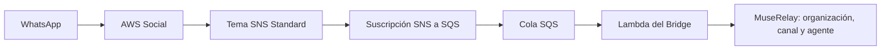

# Incorporación de WhatsApp mediante AWS End User Messaging Social

Documento técnico y de producto. Revisado el **25 de octubre de 2026, Europe/Paris**. Describe el proceso de demostración y las decisiones pendientes para clientes/resellers. No constituye autorización para crear recursos, registrar activos, modificar permisos, activar organizaciones ni enviar mensajes. La revisión actual prepara documentación e infraestructura local; no modifica AWS ni producción.

## 1. Qué está disponible y qué es una propuesta

| Elemento | Estado y alcance |
| --- | --- |
| Conector PHP 0.4.0 y soporte modular Core | Instalados y verificados desactivados en la revisión anterior; commit Core `7252eac087973d12d243299cf8d0f03569cfddc2`, release del módulo `01e14f26a5db24cdaf1d9b6b5d6e5e1d009380e2`. Esta tarea documental no vuelve a consultar ni modificar producción. |
| Organizaciones/canales AWS | Cero autorizaciones, cero canales AWS y cinco tablas Bridge vacías en la última verificación. No se activan en este procedimiento documental. |
| Infraestructura AWS Bridge | Plantilla completa preparada; el arquitecto no ha desplegado recursos ni realizado envíos. |
| Ingreso SNS → SQS | Bootstrap preparado en [deploy/sns-bootstrap](../deploy/sns-bootstrap/README.md); tampoco desplegado por el arquitecto. |
| Alta de la demo | El usuario informa de completar la parte Meta y estar en el formulario final AWS. No equivale a una vinculación AWS finalizada y comprobada. |
| Inventario SNS | El usuario comunica lista vacía en cuenta `365470560685`, Irlanda. No hay inventario independiente por API desde esta sesión. |
| Capturas | Se recibió captura del formulario de creación SNS: cuenta/región visibles; inicialmente FIFO seleccionado, y una posterior muestra el nombre preparado sin sufijo y límite 256 KiB. No se recibió aquí una captura verificable de la lista vacía ni confirmación de creación. |
| Asistente comercial, alta automática de terceros y BYO AWS | Propuestas futuras. No implementadas ni aprobadas comercialmente por esta prueba. |

La decisión es **GO para documentar y preparar la demo; pendiente para crear recursos o finalizar el alta; no validado para vender incorporación automática de WABA ajenas**. El alta propia no acredita permisos Meta de nuestra aplicación para operar activos de terceros. No se han auditado aquí sus aprobaciones pendientes.

## 2. Qué es un tema SNS

Un tema es un punto técnico donde un servicio publica eventos y SNS los distribuye a sus suscriptores. No es la bandeja de operadores, una cuenta de WhatsApp ni un número telefónico. No confundir publicación con procesamiento del mensaje.



El diagrama describe el destino previsto, no recursos activos. La cola conserva temporalmente los eventos para el consumidor; el tema no ofrece por defecto un historial recuperable por una suscripción creada más tarde. SNS Standard puede repetir/reordenar eventos; la deduplicación del Bridge y sus límites siguen siendo necesarios. La demo no certifica escalabilidad para miles de usuarios.

Registrar el número no instala por sí solo la bandeja ni el agente: el Bridge es la conexión con esas capacidades de MuseRelay. Tampoco basta con registrar y dejar apagada la publicación de eventos. La [guía de multimedia y tamaños](MEDIA-AND-PAYLOAD-LIMITS.md) explica esa separación, el límite SNS y las funciones que realmente implementa hoy el módulo.

Un operador autorizado, CloudFormation o el asistente AWS Social pueden crear el tema. La guía de registro contempla elegir un tema existente o solicitar uno nuevo dentro del propio flujo. Meta no lo crea por el mero registro del teléfono. AWS devuelve su ARN, que debe verificarse en el recurso real; no es una contraseña ni el ID de WABA.

Fuente: [registro AWS](https://docs.aws.amazon.com/social-messaging/latest/userguide/getting-started-whatsapp.html), [suscripción SNS](https://docs.aws.amazon.com/sns/latest/dg/sns-create-subscribe-endpoint-to-topic.html).

## 3. Identificadores y responsables

| Dato | Qué identifica / responsabilidad |
| --- | --- |
| Teléfono E.164 | Número controlado y autorizado por su titular; no lo compra ni lo crea el Bridge. |
| Portfolio empresarial / WABA Meta | Activos empresariales gestionados en Meta. Registrar titular, administradores y consentimiento; no atribuir propiedad a AWS por utilizar su transporte. |
| ID numérico WABA Meta | Identificador mostrado por Meta; la demo comunica `29207063275646749`. |
| `metaPhoneNumberId` | ID Meta del teléfono, distinto del número visible y del ID WABA. Pendiente de recopilar/verificar para la demo. |
| Cuenta AWS / región | Titular de recursos, facturación y permisos AWS: Screen Art `365470560685`, `eu-west-1` para la demo. |
| ID/ARN WABA vinculado AWS | Identificador devuelto por Social, normalmente `waba-…` o ARN `…:waba/…`; no sustituirlo por el ID numérico Meta. Pendiente. |
| ID/ARN teléfono AWS | Recurso Social `phone-number-id-…` / `…:phone-number-id/…`, usado por el SDK y sus permisos. Pendiente. |
| ARN SNS | Identifica tema/cuenta/región; debe ser devuelto y confirmado por AWS. |
| Organización/workspace/canal/agente/buzón | Propiedad y contexto dentro de MuseRelay. No inferirlos del nombre visible del teléfono. |
| PIN, OTP y claves | Secretos. No incorporarlos a este documento, capturas, Git, URLs ni logs. |

La guía AWS exige conceder a su servicio acceso/control operativo sobre la WABA durante la asociación; no presentar esta operación como una simple lectura o permiso IAM. Referencias: [alta AWS](https://docs.aws.amazon.com/social-messaging/latest/userguide/getting-started-whatsapp.html), [ID WABA AWS](https://docs.aws.amazon.com/social-messaging/latest/APIReference/API_PutWhatsAppBusinessAccountEventDestinations.html), [teléfono AWS/Meta](https://docs.aws.amazon.com/social-messaging/latest/APIReference/API_WhatsAppPhoneNumberDetail.html).

## 4. Registro y verificación del teléfono

1. Confirmar titular, cuenta AWS correcta, región y administrador empresarial autorizado. Usar activos exclusivos de prueba mientras no exista un proceso comercial aprobado.
2. Inventariar WABA, teléfonos, proveedor y destino actuales. No migrar un activo de los canales Meta directos actuales para esta demo. Seleccionar un activo existente no garantiza que su transporte siga igual.
3. Desde AWS Social iniciar el registro integrado y completar la interacción Meta para seleccionar/crear los activos autorizados y verificar la posesión del teléfono. La recepción del OTP por SMS/llamada corresponde al titular.
4. Distinguir el **OTP temporal** recibido para verificar el número del **PIN de seis dígitos de verificación en dos pasos**, que se configura/conoce para registrar el teléfono. Tampoco es el MFA de AWS. No resetear un PIN existente sin permiso.
5. Seleccionar la localización Meta de datos, registrar los IDs no secretos y preparar el destino de eventos. Finalizar el formulario AWS cambia la asociación y puede habilitar facturación: necesita autorización independiente.
6. Comprobar después, en lectura, estado de registro, WABA vinculada, teléfono, nombre/calidad y destino efectivo. El éxito de la ventana Meta no demuestra que todos estos pasos hayan terminado.

La API [AssociateWhatsAppBusinessAccount](https://docs.aws.amazon.com/social-messaging/latest/APIReference/API_AssociateWhatsAppBusinessAccount.html) está documentada para uso mediante la consola AWS durante el alta. No planificar una llamada backend universal ni automatizar tokens/callbacks internos de esa consola. La existencia de un método en un SDK no acredita un flujo SaaS soportado. [PIN y localización en la finalización AWS](https://docs.aws.amazon.com/social-messaging/latest/APIReference/API_WabaPhoneNumberSetupFinalization.html).

## 5. Localización de datos y protección de datos

La selección comunicada **EU (Germany)** corresponde a la localización de Meta (`DE`), distinta de la región AWS `eu-west-1`. No obliga por sí misma a crear SNS en Frankfurt ni acredita residencia de todo el sistema exclusivamente en Alemania. Comprobar la asociación Social en Irlanda y usar SNS/SQS en esa región para este diseño. Mantener por separado el mapa de Meta, colas, secretos, logs, almacenamiento MuseRelay, backups e inferencia Bedrock; los perfiles Bedrock EU pueden enrutar a otras regiones europeas.

Para un futuro servicio comercial, definir finalidad/base jurídica, reparto de responsabilidades y contratos, información al usuario, destinatarios/transferencias, retención y borrado por componente. Minimizar datos en eventos y logs y registrar accesos. Elegir una región y activar cifrado son controles parciales, no una certificación RGPD. La revisión contractual/comercial no queda resuelta por esta demo.

Fuentes: [localización Meta en el esquema AWS](https://docs.aws.amazon.com/social-messaging/latest/APIReference/API_WabaPhoneNumberSetupFinalization.html), [SNS Publish y región](https://docs.aws.amazon.com/sns/latest/api/API_Publish.html), [principios RGPD — Comisión Europea](https://commission.europa.eu/law/law-topic/data-protection/information-business-and-organisations/principles-gdpr_en), [perfiles Bedrock](https://docs.aws.amazon.com/bedrock/latest/userguide/inference-profiles-support.html).

## 6. Formulario SNS: campo por campo

Estado de la pantalla: formulario abierto, recurso **no creado** según el usuario. La captura inicial mostraba FIFO; debe seleccionarse **Estándar**. AWS Social no admite temas FIFO. Los campos FIFO no son ajustes de rendimiento que debamos activar para esta demo.

| Campo | Preparación para esta demo / motivo |
| --- | --- |
| Cuenta y región | `365470560685`, Europa (Irlanda), `eu-west-1`. |
| Tipo | **Estándar**. No FIFO. |
| Nombre | `muserelay-aws-bridge-stage-inbound`, sin `.fifo`. |
| Nombre para visualización | Vacío; no es el nombre WhatsApp y no usamos la entrega SMS de SNS. |
| Tamaño máximo | Mantener **256 KiB**. El banner de 1 MiB no acredita compatibilidad del Bridge: el código impone límites propios inferiores. No aumentarlo en esta fase. |
| Alto rendimiento / grupos FIFO | No aplican al tema Standard. |
| Deduplicación por contenido FIFO | No aplica; no sustituye la idempotencia persistente del Bridge. |
| Cifrado en reposo | IaC ya preparada con SSE-KMS y clave simétrica dedicada de staging; todavía NO desplegada. Ver sección 8 y runbook CloudFormation. No crear manualmente desde este formulario. |
| Política de acceso | Preparar la declaración exacta de la sección 7; solo el propietario por defecto no basta para la publicación de Social. No acceso público. |
| Archivado | No activar. La cola SQS es el buffer previsto; no se ha diseñado replay desde archivo SNS. |
| Logs de entrega | No activar todavía. Se revisarán junto a retención, coste y permisos de logging; no confundirlos con estados de entrega de WhatsApp. |
| Etiquetas | Alineadas con IaC: `Company=ScreenArt`, `Project=MuseRelay`, `Component=aws-engagement-bridge`, `Environment=staging`, `Purpose=hackathon`. |
| Rastreo X-Ray | Desactivado; no hace falta para resolver este bloqueo y tiene coste/permiso propios. |
| Botón final «Crear un tema» | **No pulsar en esta fase documental. Se recomienda la plantilla revisada.** |

El ARN previsto, **todavía no verificado como recurso existente**, es:

```text
arn:aws:sns:eu-west-1:365470560685:muserelay-aws-bridge-stage-inbound
```

La plantilla usa `TopicName: ${AWS::StackName}-inbound`; ese nombre coincide si el stack se llama exactamente **`muserelay-aws-bridge-stage`**. Mantener el nombre no garantiza que CloudFormation adopte un tema creado fuera de él.

**Decisión recomendada:** crear, tras autorización, el [bootstrap SNS/SQS](../deploy/sns-bootstrap/README.md) con ese nombre de stack. Sus doce recursos cifrados conservan los logical IDs y propiedades del ingreso de la plantilla completa. Más adelante actualizar el **mismo stack** con el resto del Bridge, revisando que el change set no sustituya el ingreso. No crear primero el tema manualmente y después desplegar a ciegas el stack completo con el mismo nombre físico.

Si se elige creación manual, documentar ARN, políticas, propietario y etiquetas y preparar antes una importación soportada/revisada o adaptación explícita para recursos externos. Esa adaptación no está implementada ahora. No borrar y recrear un tema para resolver un conflicto de propiedad.

Fuentes: [Standard/FIFO y configuración Social](https://docs.aws.amazon.com/social-messaging/latest/userguide/managing-event-destinations-add.html), [propiedad TopicName en CloudFormation](https://docs.aws.amazon.com/AWSCloudFormation/latest/TemplateReference/aws-resource-sns-topic.html). Evidencia de compatibilidad con el Bridge: `template.yaml`, `src/normalize.ts`, `src/contracts.ts` y `src/handlers.ts`.

## 7. Política exacta de publicación y suscripción

Declaración de política del recurso SNS para el tema nuevo dedicado. Disponible también como [JSON preparado](../deploy/sns-bootstrap/topic-policy.prepared.json):

```json
{
  "Version": "2012-10-17",
  "Statement": [
    {
      "Sid": "AllowScreenArtSocialPublish",
      "Effect": "Allow",
      "Principal": { "Service": "social-messaging.amazonaws.com" },
      "Action": "sns:Publish",
      "Resource": "arn:aws:sns:eu-west-1:365470560685:muserelay-aws-bridge-stage-inbound",
      "Condition": {
        "StringEquals": { "aws:SourceAccount": "365470560685" },
        "ArnLike": {
          "aws:SourceArn": "arn:aws:social-messaging:eu-west-1:365470560685:*"
        }
      }
    }
  ]
}
```

Es la autorización del servicio para publicar, no una trust policy de rol IAM ni un permiso de envío WhatsApp. Si ya hay una política, revisar y combinar declaraciones sin eliminar accesos legítimos del propietario. No usar `Principal:"*"` para permitir publicación pública. El patrón SourceArn sigue el ejemplo oficial regional; el ID Meta no sirve para inventar un ARN AWS. Refinar su alcance solo al conocer/verificar el origen AWS real.

Suscripción del Bridge: protocolo `sqs`, destino ARN real de `InboundQueue`, **`RawMessageDelivery:false`**, sin filtros en esta demo. Así se conserva el sobre SNS (`Type`, `TopicArn`, `Message`) que espera el normalizador. El endpoint HMAC de MuseRelay no es un receptor SNS directo compatible.

La política SQS permite únicamente `sqs:SendMessage` desde `sns.amazonaws.com`, con `aws:SourceArn` igual al tema y `aws:SourceAccount` igual a Screen Art. La cola usa SSE administrado de SQS, cuatro días de retención, visibilidad 180 s y DLQ de procesamiento a cinco recepciones, retenida 14 días. No confundir esa DLQ con una DLQ de fallo de entrega de la suscripción SNS. Crear el tema sin suscripción no prepara por sí solo recepción reproducible.

Una WABA admite un destino de eventos y lo comparten todos sus teléfonos: consultar el actual antes de guardarlo o reemplazarlo. [Destino y ámbito WABA](https://docs.aws.amazon.com/social-messaging/latest/APIReference/API_PutWhatsAppBusinessAccountEventDestinations.html), [políticas oficiales](https://docs.aws.amazon.com/social-messaging/latest/userguide/managing-event-destinations-add.html), [suscripciones SNS](https://docs.aws.amazon.com/sns/latest/dg/sns-create-subscribe-endpoint-to-topic.html).

## 8. Cifrado SNS y KMS

**Decisión incorporada a IaC: SNS con SSE-KMS y clave simétrica dedicada de staging en Irlanda.** Ambas plantillas ya declaran `KmsMasterKeyId`, clave, alias y política Social restringida. No se han desplegado: no existe aquí evidencia de un tema cifrado real. SQS usa SSE-SQS y TLS es un control separado. Detalles, administrador no-root requerido y validación en [CLOUDFORMATION-DEPLOYMENT.md](CLOUDFORMATION-DEPLOYMENT.md).

La plantilla conserva administración explícita mediante `KmsAdministratorArn` y esta autorización de Social. El siguiente fragmento es solo la concesión Social de la **política de esa clave**, no una política administrativa completa:

```json
{
  "Sid": "AllowScreenArtSocialUseOfSnsKey",
  "Effect": "Allow",
  "Principal": { "Service": "social-messaging.amazonaws.com" },
  "Action": ["kms:GenerateDataKey*", "kms:Decrypt"],
  "Resource": "*",
  "Condition": {
    "StringEquals": { "aws:SourceAccount": "365470560685" },
    "ArnLike": {
      "aws:SourceArn": "arn:aws:social-messaging:eu-west-1:365470560685:*"
    }
  }
}
```

Aquí `Resource:"*"` está dentro de la política de **una clave concreta** y no concede acceso a todas las claves de la cuenta. Mantener también la política SNS: una autorización KMS no sustituye `sns:Publish`. No elegir simplemente `alias/aws/sns`: la compatibilidad con un emisor de servicio exige revisar la política de clave y las claves administradas por AWS no permiten personalizarla como una clave propia.

La administración/uso por identidades operadoras debe revisarse por separado con mínimos permisos; no conceder `kms:*` al runtime del Bridge. No añadir permisos de descifrado de esta clave SNS a Lambda por el mero hecho de consumir SQS: el cifrado de la cola es otra capa. Si la cola pasa a usar una clave propia, revisar también permisos del productor SNS y consumidor SQS.

La mejora está preparada localmente y necesita revisión de identidad/permisos y autorización antes de desplegar. No crear roles/claves ni modificar IAM desde el formulario SNS. El coste KMS se añade al [ingreso preparado](../deploy/sns-bootstrap/README.md). Una clave cuesta por clave, no por número ni WABA: se puede compartir entre recursos compatibles autorizados, sin que eso sustituya el aislamiento por organización. Separar staging/producción; las claves por partner/BYO son una decisión futura.

Referencia de coste: una clave propia simple cuesta aproximadamente **USD 1/mes, prorrateado por horas**, más peticiones e impuestos; cuatro días representan aproximadamente USD 0,13 de almacenamiento de clave. No presupone créditos/free tier, ni incluye retenerla después o rotaciones adicionales. [Precio oficial KMS](https://aws.amazon.com/kms/pricing/).

Fuente: [AWS Social: temas cifrados y permisos de clave](https://docs.aws.amazon.com/social-messaging/latest/userguide/managing-event-destinations-add.html), [SNS y claves KMS](https://docs.aws.amazon.com/sns/latest/dg/sns-key-management.html).

## 9. IAM, acceso y separación de responsabilidades

- Operador de lectura: comprobar identidad STS y cuenta antes de listar temas/atributos/suscripciones, metadatos de cola, stack y demo Social. Sin root AWS, valores de secretos, cuerpos de mensajes ni invocaciones.
- Operador de despliegue: permisos revisados sobre recursos concretos, después de autorización. La sesión del usuario en el navegador no configura credenciales en este servidor. Que aquí falten perfiles no demuestra que su cuenta carezca de permisos.
- Publicación Social → SNS: política de recurso de la sección 7 y KMS si procede. No requiere crear un rol Lambda para que Social publique.
- Runtime Bridge: roles Lambda separados; solo el emisor tiene `social-messaging:SendWhatsAppMessage` sobre el teléfono aprobado. Recepción, estado, secreto y logs quedan limitados a sus propios recursos en la plantilla.
- Core ↔ Bridge: HTTPS y HMAC con claves diferentes por sentido/binding, nonces y comprobación de identidad. Secrets Manager no debe convertirse en un mecanismo para pasar claves en chat/Git.
- Futuro BYO: rol entre cuentas con confianza explícita en la identidad de MuseRelay, `sts:AssumeRole`, `ExternalId` único por cliente y credenciales temporales. No solicitar credenciales root ni claves IAM permanentes al partner. Esto es diseño futuro, no funcionalidad existente.

[Permisos y recursos de demo](AWS-LIVE-CHECKLIST.md), [roles AWS para terceros y ExternalId](https://docs.aws.amazon.com/IAM/latest/UserGuide/id_roles_common-scenarios_third-party.html). Cambiar políticas de recurso también es un cambio de permisos aunque no se cree un rol IAM.

## 10. Conectar con organización y canal MuseRelay

La instalación definitiva reutiliza paneles/dominios, PostgreSQL, Redis, bandeja y herramientas existentes. No necesita una segunda instalación comercial. Los datos de ensayo y su staging siguen aislados y temporales.

Registrar, tras autorización, un binding explícito que una cuenta/región, IDs WABA/teléfono Meta y ARN teléfono AWS con una organización, workspace, canal WhatsApp `managed_provider=aws_social`, agente y buzón válidos. El código verifica su pertenencia y la asignación del agente; no elegir una organización por el texto del mensaje ni reutilizar un canal Meta directo.

Mantener apagados inicialmente módulo, binding, lista de destinatarios y `LiveSend`. Preparar claves, endpoint y agente Bedrock de demo con sus fallbacks antes de habilitar un ensayo. El control `/megadmin/extensions` existe; no hay aún un asistente de alta AWS por canal. El preflight local no certifica permisos efectivos, cuotas ni aprobación Meta. Las herramientas nativas de tickets se probaron con simulaciones AWS; no se ha validado aquí una herramienta nueva de calendario ni un servicio comercial BYO.

Implementación: `integration/muserelay/src/Core/Store.php`, `CoreReadiness.php`, `NativeCore.php`; [arquitectura modular](CORE-EXTENSIONS.md) y [última verificación instalada](POST-INSTALL-VERIFICATION.md). Las pruebas sintéticas no se instalan en producción.

## 11. Prueba real y evidencia: solamente tras autorización

1. Revisar ARN devueltos, región/cuenta, permisos de publicación/cola/KMS, suscripción confirmada y consumidor. Obtener todos los IDs reales y no sustituirlos por ejemplos.
2. Autorizar explícitamente recursos, coste, organización y destinatarios exclusivos de prueba. Habilitar cada capa de la demo de manera controlada; activar `LiveSend=false` no impide por sí solo costes de recepción o inferencia.
3. El probador inicia conversación desde su teléfono. Verificar evento Social, sobre SNS, SQS, Lambda, firma, binding, mensaje y agente nativos; después Bedrock, comando de salida, Social y recepción WhatsApp. Sin suscripciones SNS de email/SMS para este flujo.
4. Ensayar dos turnos y confirmación antes de crear ticket. Correlacionar IDs reales con el ticket y la respuesta; no registrar texto personal ni secretos.
5. Verificar estados `sent`, `delivered`, `read` o `failed`. Aceptación de API/cola no equivale a entrega; `read` puede no recibirse si el usuario no comparte confirmaciones. El normalizador actual solo procesa texto y esos cuatro estados; no prometer cobertura de todos los eventos de Social.
6. Verificar duplicados, reintentos, pausas, límites y desconexión; reconciliar envíos inciertos antes de repetirlos. No reenviar para obtener una prueba más bonita.

Guardar run ID, cuenta/región, hashes de release, timestamps, IDs de correlación protegidos, eventos técnicos/estados y resultado. Diferenciar siempre simulación, dato comunicado, comprobación de lectura y evidencia real. [Estados AWS](https://docs.aws.amazon.com/social-messaging/latest/userguide/managing-event-destinations-status.html), [runbook de demo](PHASE-4-RUNBOOK.md).

## 12. Modelos comerciales propuestos

| Aspecto | AWS gestionado por MuseRelay | BYO AWS del partner/reseller |
| --- | --- | --- |
| Recursos y facturación AWS | Cuenta(s) de la plataforma, con separación por cliente por definir. | Cuenta del partner; delegación limitada a MuseRelay. |
| Experiencia deseada | Cliente opera en su panel habitual y autoriza sus activos; SNS/ARN/IAM quedan detrás del servicio. | Panel habitual más una autorización técnica inicial del titular AWS; después ocultar detalles al operador cotidiano. |
| Activos Meta | Titular/administradores y autorización empresarial siguen siendo necesarios; no poner activos ajenos indiscriminadamente en la WABA de Screen Art. | Igual: el rol IAM no concede derechos sobre Meta ni sustituye su alta. |
| Estado actual | La demo propia explora el transporte; no prueba onboarding comercial de terceros. | No implementado; el validador de preparación/CoreReadiness fija esta demo a Screen Art/Irlanda. |
| Antes de ofrecerlo | Validar con AWS/Meta el modelo ISV/Tech Provider/condiciones aplicables, aislamiento, permisos, facturación, límites, soporte y baja. | Además, implementar y probar confianza entre cuentas, ExternalId, renovación/revocación y despliegue en cuenta ajena. |

Son decisiones de producto, no una aprobación de AWS/Meta ni una promesa de botón universal. No extrapolar requisitos de otro BSP o de SMS a WhatsApp Social. Se debe estudiar un flujo oficialmente soportado antes de automatizar el registro interactivo. Sí puede automatizarse nuestra infraestructura y la asociación interna tras recibir autorización y disponer de los activos.

## 13. Manual, automatizable y sujeto a terceros

| Paso | Naturaleza / autorización |
| --- | --- |
| Acreditar titular, consentir acceso a activos y condiciones | Titular/administrador; interacción y decisión empresarial. |
| Login Meta, OTP y PIN | Interactivo/confidencial; no capturar ni automatizar por scraping. |
| Revisión de negocio, nombre y elegibilidad/migración | Meta/AWS; no bajo SLA propio de MuseRelay. |
| Inventario de recursos y preflight | Automatizable en lectura con identidad autorizada; no habilita cambios. |
| Crear SNS/SQS, políticas, claves y consumidores | Automatizable con IaC después de autorización; permisos/costes revisados. Bootstrap preparado, KMS adicional pendiente. |
| Asociar destino WABA | API oficial disponible para activos ya vinculados, pero es escritura y afecta a todos los números de esa WABA. |
| Crear binding y validar ownership | Código interno preparado; el asistente comercial aún no existe. Toda activación exige aprobación. |
| Enviar, inferir, crear ticket y recopilar evidencia real | Automatizable para un ensayo autorizado y acotado; no ejecutado en esta revisión. |
| Desconectar y reconciliar | Controles Core existentes más operación AWS revisada; no retirada automática universal. |

## 14. Desconexión sin alterar los canales restantes

Para un canal, deshabilitar su binding mediante operación administrativa revisada; para una organización, retirar su autorización conservando las demás cuando proceda. Para toda la extensión, usar su desconexión en Megadmin. No confundirlo con ocultar una sección del panel. El módulo desactivado rechaza nuevas entradas/claims/publicaciones protegidas, sin fallback silencioso a Meta directo.

La desconexión no cancela una operación en curso ni retira mensajes ya aceptados por AWS. Revisar por separado consumidor, colas, destinatarios y destino Social antes de detenerlos. No reemplazar/quitar un destino compartido por otros teléfonos ni detener workers nativos. Conservar mensajes, tickets e historial según retención acordada; no borrar tablas o restaurar toda la base para apagar un módulo. [Reversión verificada](CORE-ROLLBACK.md).

Desvincular WABA, migrar teléfono, eliminar stack/clave o revocar el rol de un partner son operaciones distintas que requieren autorización y análisis de dependencias. La prueba de baja BYO completa sigue pendiente.

## 15. Registro de incorporación de la demo

| Paso | Estado conocido y procedencia |
| --- | --- |
| Acceso al registro Social y ventana Meta | Completado según el usuario. |
| Selección/alta WABA Meta | El usuario comunica ID `29207063275646749`; falta confirmación del recurso vinculado AWS. |
| Verificación del teléfono | Completada según el usuario para el número de demostración terminado en `9169`. No se almacena OTP. |
| Localización | Usuario informa EU (Germany); falta lectura del atributo efectivo después de completar AWS. |
| PIN de dos pasos | Pendiente de confirmar configuración, sin solicitar su valor. |
| Inventario SNS | Usuario comunica cero temas en Screen Art/Irlanda. No convertirlo en prueba API ni deducirlo solo de la captura del formulario. |
| Formulario SNS inicial | Captura recibida: FIFO seleccionado; se indicó cambiar a Standard, sin `.fifo`. |
| Formulario preparado posterior | Usuario confirma Standard; captura muestra nombre `muserelay-aws-bridge-stage-inbound` y 256 KiB. Todavía sin creación. |
| Publicación desactivada | Un texto posterior aportado por el usuario describe desmarcar la publicación y la advertencia de que no se recibirán mensajes. Se registra como información comunicada; no hay aquí captura nueva/API del estado ni confirmación de finalizar el alta. |
| Política, cifrado y método de creación | Documentados aquí; recomendación IaC y revisión KMS antes de tráfico real. Sin aplicación. |
| Creación SNS/SQS, destino y finalización AWS | Pendientes de autorización, creación y verificación. |
| IDs reales vinculados, consumidor y conversación | Pendientes. No hay evidencia de envíos reales del Bridge. |

Las capturas se usan como evidencia de lo visible, no de páginas anteriores o permisos efectivos. Antes de incorporarlas al repo privado, disponer del archivo original y una versión revisada sin PIN, OTP, claves, tokens, cookies, QR de acceso ni datos ajenos. La revisión actual registra su contenido técnico; no ha guardado ni fabricado imágenes en Git.

La formulación de producto recomendada es: **«MuseRelay busca ofrecer WhatsApp desde sus paneles habituales, gestionando la infraestructura técnica cuando el modelo autorizado lo permita. La demo valida primero el transporte de una WABA propia; el alta comercial de terceros y BYO AWS requieren trabajo y validaciones adicionales».**

## 16. Tamaño de eventos y multimedia: aclaración posterior

Mantener **256 KiB** como límite SNS previsto para la demo. No es un límite directo del archivo WhatsApp, SNS no comprime imágenes y ampliar el atributo a 1 MiB no amplía automáticamente el Bridge. El módulo actual admite **texto y estados**, y omite multimedia deliberadamente; no implementa todavía recuperación, almacenamiento o visualización de imágenes/audios/documentos por la ruta AWS. La capacidad de otros canales nativos no cambia por ello.

Véase [MEDIA-AND-PAYLOAD-LIMITS.md](MEDIA-AND-PAYLOAD-LIMITS.md) para el detalle del código, condiciones SNS, ejemplos de rechazo y requisitos futuros. Esta limitación debe figurar en cualquier demo/descripción comercial; no presentar una explicación arquitectónica futura como funcionalidad ya instalada.

## 17. CloudFormation y las dos etapas acordadas

Se abandona la creación manual del tema. El usuario confirma IaC y está explorando el asistente CloudFormation, sin pila creada según lo comunicado. La preparación actual entrega **dos archivos para la misma pila**: ingreso cifrado de doce recursos, luego UPDATE del runtime con IDs finales. Véase [plantillas, recursos exactos, coste, validación y procedimiento](CLOUDFORMATION-DEPLOYMENT.md). No confundir esta decisión con autorización para ejecutar.

El primer YAML se podrá cargar desde consola después de aprobarlo. La segunda etapa necesita además el ZIP Lambda privado en S3; la consola puede desplegar el YAML completo con esa referencia sin SAM CLI. La carga de un YAML al asistente puede escribir en un bucket S3 de plantillas antes de crear la pila. No afirmar que todos los pasos previos al botón final son de solo lectura. El ARN se copiará del output real y se contrastará con SNS; no usar el previsto como si estuviera creado.

El número de demo comunicado se conserva como objetivo del alta. No se necesita otro por dividir la infraestructura en etapas, aunque reanudar una sesión caducada puede requerir pasos interactivos Meta/AWS. El registro efectivo, PIN configurado, destino y IDs AWS siguen pendientes de comprobación.
