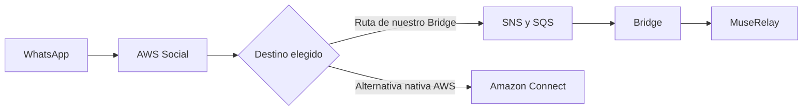
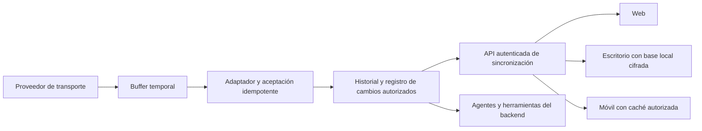

# Ideas de evolución: Connect, MuseRelay personal, empresa e híbrido

Registro de producto y arquitectura del **25 de octubre de 2026, Europe/Paris**, a partir de la conversación facilitada por el usuario. Su preferencia expresa es explorar **ambas modalidades, individual y empresa, y una combinación híbrida**. No constituye una orden de desarrollarlas, una promesa comercial ni una autorización de infraestructura. En esta tarea solo cambia documentación.

La prioridad inmediata sigue siendo la primera conversación real del Bridge antes del 28 de octubre. Desktop, Mobile, BYO AWS, despliegue privado, sincronización offline y Amazon Connect quedan fuera de ese ensayo. No se cambia la arquitectura ni el alcance de las [dos etapas CloudFormation](CLOUDFORMATION-DEPLOYMENT.md).

## 1. Qué aporta cada pieza

| Pieza | Responsabilidad | Lo que no aporta automáticamente |
| --- | --- | --- |
| AWS End User Messaging Social | Vinculación WhatsApp Business, API de transporte y eventos. | Panel reseller MuseRelay, herramientas nativas o historial sincronizado de dispositivos. |
| Amazon SNS | Publicar/distribuir eventos a suscriptores. | Buzón permanente ni sincronización de una bandeja humana. |
| Amazon SQS | Cola de trabajo y retención temporal de eventos pendientes. | Historial de conversaciones, búsqueda, permisos de operadores o copia independiente para cada dispositivo. |
| Amazon Connect | Plataforma de centro de contacto con configuración de canales, flujos y atención de agentes. | Integración con los paneles y herramientas propias de MuseRelay sin trabajo adicional. |
| MuseRelay Core | Contexto de organización, permisos, bandeja, agentes y herramientas nativas. | App local, sincronización offline o despliegue privado certificados por instalar el Bridge. |
| AWS Engagement Bridge | Adaptar eventos/comandos entre el transporte AWS y el Core mediante contratos autenticados. | Sustituir todo el Core, registrar cualquier WABA de terceros automáticamente o sincronizar dispositivos. |

La idea de producto es separar **transporte, procesamiento empresarial/IA, almacenamiento e interfaz**. Es una dirección de diseño: no afirmamos que el Core actual ya permita intercambiar todas esas capas sin adaptación. El MVP de AWS procesa texto y determinados estados; multimedia sigue pendiente, según [MEDIA-AND-PAYLOAD-LIMITS.md](MEDIA-AND-PAYLOAD-LIMITS.md).

## 2. Amazon Connect: otra ruta soportada por AWS

La documentación AWS permite elegir SNS o una instancia Connect como destino. Para Connect se seleccionan instancia y rol IAM, se importa el teléfono y se configura su flujo de contacto. Ese recorrido nativo **no exige crear manualmente nuestro tema SNS**. Tampoco elimina requisitos de Meta, verificación, permisos ni configuración de la instancia. Referencias: [destinos Social](https://docs.aws.amazon.com/social-messaging/latest/userguide/managing-event-destinations-add.html), [configuración WhatsApp en Connect](https://docs.aws.amazon.com/connect/latest/adminguide/whatsapp-integration.html).

El diagrama representa alternativas, no una configuración simultánea aprobada. AWS documenta un tema SNS asociado por WABA, con eventos de todos sus teléfonos; no asumir que el mismo alta entrega a SNS y Connect a la vez. Cualquier coexistencia necesitaría comprobar el contrato soportado y diseñar su coordinación. No cambiar el destino de la demo para explorar Connect. [Ámbito del destino](https://docs.aws.amazon.com/social-messaging/latest/userguide/managing-event-destinations-add.html).

Connect tiene un procedimiento guiado porque ya incorpora una aplicación de atención y sus flujos; nuestro trabajo integra el transporte con la aplicación MuseRelay. No hay una valoración global de que uno sea superior: se comparan necesidades del cliente, administración, costes, agentes, marca blanca y control de datos. No se ha realizado un benchmark ni una auditoría funcional de Connect en esta cuenta.

## 3. Mercado y experiencia de incorporación

Se registran dos propuestas comerciales futuras:

| Modelo | Experiencia que se busca | Trabajo pendiente |
| --- | --- | --- |
| AWS gestionado por MuseRelay | El cliente utiliza sus paneles habituales; el operador gestiona SNS/IAM y demás recursos. | Permisos de terceros, asistente de alta, aislamiento, facturación, soporte y baja segura. |
| BYO AWS de empresa/partner | El titular conserva su cuenta y autoriza acceso delimitado a MuseRelay. | Roles entre cuentas, credenciales temporales, consentimiento, inventario, despliegue y revocación verificables. |

No ofrecer todavía un botón universal «Conectar cualquier WABA». Los pasos Meta/AWS y su elegibilidad siguen siendo condiciones externas. El alta de nuestra WABA propia no acredita aprobación comercial como Meta Tech Provider para activos ajenos. El [onboarding actual](AWS-WHATSAPP-ONBOARDING.md) separa lo manual, automatizable y dependiente de terceros.

En el intercambio se mencionan Zendesk, respond.io y Trengo como ejemplos de bandejas omnicanal. **No se ha comprobado aquí su compatibilidad específica con WABA vinculadas a AWS Social**. Hospedarse en AWS o soportar WhatsApp no demuestra esa compatibilidad. Una futura investigación debería pedir documentación oficial del método de conexión, propiedad/migración del número, eventos, herramientas, aislamiento y condiciones comerciales; no presentarlas ahora como alternativas validadas del Bridge.

## 4. Modalidades de producto que interesa estudiar

| Modalidad propuesta | Interfaz | Ubicación principal del historial | Decisión pendiente |
| --- | --- | --- | --- |
| SaaS MuseRelay | Web y, eventualmente, clientes de escritorio/móvil. | Backend de MuseRelay, como en el modelo actual. | Qué necesita una app adicional y qué puede reutilizar la web. |
| Personal con prioridad local | App para un profesional y sus dispositivos autorizados. | Base local cifrada, con entrega temporal intermedia. | Periodo máximo sin conexión, recuperación y si hay un segundo dispositivo. |
| Empresa | Web, escritorio y móvil para varios empleados. | Estado común en el backend que se acuerde. | Asignaciones, permisos, auditoría y conflictos entre operadores. |
| Enterprise / privado / BYO | Clientes conectados al backend controlado por empresa o partner. | Infraestructura del titular, bajo condiciones documentadas. | Instalación, actualizaciones, copias, soporte y acceso del proveedor. |
| Híbrida | Una organización combina interfaces y cachés locales. | Una autoridad común definida más las copias locales autorizadas. | Qué datos se replican, a quién y durante cuánto tiempo. |

Las modalidades pueden compartir contratos y parte de la lógica, pero no se promete construir cuatro productos por el coste de uno. Un envoltorio de la web puede ofrecer una interfaz de escritorio; **no aporta por sí solo funcionamiento offline ni historial local independiente**. La selección entre aplicación web, PWA o tecnologías nativas/multiplataforma queda abierta: este documento no elige un framework ni inicia su implementación.

BYO AWS indica quién controla una cuenta/infraestructura; prioridad local indica dónde se conserva el historial. Son decisiones distintas: se puede tener infraestructura propia con datos centralizados en nube, y una app local puede utilizar proveedores de transporte distintos de AWS.

## 5. Desconexión: qué guarda AWS y qué tendríamos que construir

SQS permite retención de **4 días por defecto y hasta 14 días configurables**. Ese plazo es una condición de la cola, no una garantía de que cada dispositivo tendrá una copia disponible durante ese periodo. Los mensajes pueden borrarse antes después de procesarlos; cuando caducan ya no son recuperables por esa cola. En la plantilla de demo las colas principales tienen cuatro días y las DLQ catorce. No se han cambiado esos valores. [Atributos de retención SQS](https://docs.aws.amazon.com/AWSSimpleQueueService/latest/APIReference/API_SetQueueAttributes.html).

El consumidor actual entrega al Core y termina el trabajo de transporte cuando se confirma su aceptación; no espera a que un teléfono o escritorio abra la conversación. SQS no sabe qué operador leyó el mensaje. Un mensaje borrado tras su procesamiento no queda reservado para otros dispositivos: **varios consumidores de una cola no constituyen una difusión del historial a cada empleado**. [Recepción, visibilidad y borrado SQS](https://docs.aws.amazon.com/AWSSimpleQueueService/latest/SQSDeveloperGuide/step-receive-delete-message.html).

Por eso «apago el ordenador dos días y al volver recibo todo» solo sería un comportamiento garantizado dentro de condiciones diseñadas y probadas. Si el backend sigue activo puede persistir/sincronizar mientras el ordenador está apagado. Si el único backend está en ese ordenador, no habrá IA/herramientas automáticas funcionando allí durante la desconexión; la espera dependerá del buffer y sus límites. Un mes apagado requiere otra conservación autorizada si se promete recuperar el historial. Una DLQ atiende errores; no sustituye un archivo de usuario.

Arquitectura conceptual futura para empresa o híbrido:

**Diseño propuesto, no componentes desplegados.** La ubicación de H sería elegida para la modalidad: MuseRelay, backend del cliente o almacenamiento local con un buffer/relay definido. No todas las variantes necesitan la misma persistencia. Para varios empleados hace falta una autoridad accesible y compartida; puede estar bajo control del cliente y no implica otro SaaS de Screen Art.

Un protocolo futuro necesitaría, como mínimo:

1. Identidad y autorización de organización, usuario y dispositivo; acceso revocable y límites a los datos de cada bandeja.
2. Confirmar persistencia duradera del destino antes de cerrar la aceptación de transporte; manejar reintentos e idempotencia sin confundir recepción, sincronización y lectura humana.
3. Registro de cambios con secuencia/cursor por dispositivo, recuperación tras desconexión y política explícita cuando el cursor ya caducó. No confiar solo en la hora local.
4. Base local cifrada y protección de claves, cierre de sesión, bloqueo y tratamiento de dispositivos perdidos. La revocación no borra mágicamente una copia descargada y desconectada.
5. Comandos salientes con identificadores estables, vencimiento y reconciliación. Guardar un borrador offline no confirma envío, disponibilidad ni ejecución de una herramienta.
6. Conflictos entre operadores: asignaciones, ediciones, respuestas simultáneas, estado de tickets y citas. Confirmar acciones con la autoridad vigente al reconectar, sin aplicar reservas antiguas a ciegas.
7. Backups, recuperación, exportación/borrado y caducidad coordinados entre historial, cachés, objetos multimedia y auditoría.

Estos son requisitos para una investigación posterior; no se añade ahora una API de sincronización ni un almacenamiento nuevo.

## 6. Tickets, calendarios, IA y escalabilidad

La intención es reutilizar las herramientas nativas, evitando una segunda implementación de tickets para cada interfaz. El Bridge ya tiene pruebas integradas de la herramienta nativa de tickets con transportes AWS simulados; la primera prueba AWS/Bedrock real sigue pendiente. Las interfaces futuras consumirían contratos del backend y sus permisos, no escribirían directamente en las tablas del Core desde el móvil.

El calendario se registra como herramienta a integrar/validar en futuras etapas; esta documentación no certifica un flujo nativo nuevo de calendario ni reservas offline. Tickets y calendario necesitan definir quién confirma, audita y resuelve una operación concurrente. La idempotencia del transporte no garantiza por sí sola ejecución exactamente una vez de cualquier herramienta.

Separar una interfaz local no obliga a reescribir Laravel en Node. La pieza AWS actual usa Node/TypeScript en Lambda; la elección de un servicio de sincronización u otro runtime se evaluará según requisitos, capacidad y mantenimiento. El Core y los agentes siguen siendo servicios reutilizables cuando sus contratos lo permitan.

«Miles de usuarios simultáneos» es un objetivo de capacidad, **no una propiedad ya demostrada**. La demo restringe concurrencia y cuotas expresamente. Antes de un servicio comercial habrá que medir carga, colas, contención PostgreSQL, workers Redis, orden por conversación, límites por organización, cuotas de proveedores, latencia IA y recuperación. Ninguna elección de framework sustituye esas pruebas.

## 7. Privacidad: reducir persistencia en MuseRelay, sin promesas absolutas

Se registra la opción de **no conservar permanentemente el historial en el SaaS de Screen Art**, mediante un backend controlado por el cliente o una modalidad local bien delimitada. Es una posibilidad de diseño, no una propiedad del Bridge actual, que entrega a MuseRelay y utiliza su persistencia nativa.

Reducir las copias puede favorecer minimización y limitación de conservación; no equivale automáticamente a cumplimiento RGPD. Deben determinarse responsabilidades, finalidad, base jurídica, retención, derechos, destinatarios y medidas de seguridad. La comparación requerirá revisar la arquitectura y los contratos reales. [Principios de protección de datos — Comisión Europea](https://commission.europa.eu/law/law-topic/data-protection/information-business-and-organisations/principles-gdpr_en).

Para evaluar cada modalidad se propone un mapa de datos que incluya Meta, AWS Social, colas/DLQ, backend, base local, multimedia, backups, logs, telemetría y soporte. Si se usa Bedrock u otro proveedor IA, hay tratamiento adicional del contenido enviado al modelo aunque no se guarde historial permanente en MuseRelay. No utilizar las expresiones «datos solo en el dispositivo», «Screen Art nunca ve contenido» o «cifrado de extremo a extremo» sin demostrarlo en ese diseño específico.

Cifrado en reposo de KMS/SQS/base local y HTTPS protegen capas diferentes; no impiden por sí solos que un backend autorizado lea contenido para atender agentes/herramientas. Un esquema donde solo los dispositivos puedan descifrar tendría que resolver aparte búsqueda compartida, IA, herramientas y recuperación de claves.

No distribuir claves AWS permanentes ni firmas compartidas del backend dentro de apps instalables. Estudiar autenticación de usuarios/dispositivos y sesiones de corta duración mediante una API autorizada; un cliente público no puede mantener un secreto de servidor como garantía de identidad. Las notificaciones móviles, si se incorporan, deberían limitar su contenido y remitir a sincronización autenticada. No se ha seleccionado ni integrado ningún servicio de push.

## 8. Costes: transporte, espera e historial son conceptos distintos

La [nota adicional de costes KMS y acceso](AWS-ACCESS-AND-KMS-COSTS.md) explica el coste base por clave frente a solicitudes facturables, el ejemplo de cuatro días y la separación entre acceso root excepcional, identidad administrativa y runtime. No se calcula una clave por teléfono ni se solicita crear accesos durante esta documentación.

La tarifa Social/Meta no compra almacenamiento indefinido ni sincronización automática. El diseño futuro tendrá que presupuestar por separado transporte, publicaciones, operaciones de cola, relay/API, base de datos/objetos, cifrado, logs, copias, salida de datos, autenticación y procesamiento IA; en Connect habría además su propio modelo de uso. Más dispositivos pueden multiplicar sincronizaciones, notificaciones y copias aunque no haya más mensajes WhatsApp.

No se da aquí un precio Desktop/Enterprise: faltan volumen, número de operadores/dispositivos, periodo offline, tamaño multimedia, región, disponibilidad y proveedor IA. El presupuesto pequeño de la demo y el precio de una clave KMS **no son una tarifa comercial por cliente**. Las estimaciones actuales del ensayo están únicamente en [CLOUDFORMATION-DEPLOYMENT.md](CLOUDFORMATION-DEPLOYMENT.md); no se amplían recursos ni gasto por registrar estas ideas.

## 9. Reutilización y límites del Bridge actual

Posibles piezas reutilizables: contratos de eventos/comandos, normalización de texto/estados, validación de identidad del canal, firmas entre servicios, deduplicación, estado de envío incierto y pruebas. Hará falta revisar sus dependencias del Core antes de ofrecer un backend distinto.

La plantilla actual está deliberadamente restringida a Screen Art, Irlanda y el hostname técnico de staging. **No admite hoy desplegarse sin cambios en cualquier cuenta BYO o contra cualquier app local.** Una futura versión tendría que parametrizar lo necesario conservando aislamiento, validación de ownership, permisos mínimos, compatibilidad y reversión. Abrir esos parámetros ahora no forma parte de la prueba.

La extensión definitiva del SaaS comparte paneles, organizaciones y servicios actuales; no necesita una máquina/dominio/base/Redis por módulo. Los despliegues privados son otra modalidad opcional para quien la solicite, con responsabilidades de operación propias. El staging del concurso sigue siendo temporal y aislado, no un segundo producto comercial permanente.

## 10. Secuencia futura para tomar decisiones

| Momento propuesto | Resultado antes de ampliar alcance |
| --- | --- |
| Ahora: hackathon | Ensayo real de texto, dos turnos, confirmación y ticket nativo; registrar evidencia y costes sin afectar clientes beta. |
| Después de validar el transporte | Evaluar onboarding gestionado y BYO con casos reales autorizados; documentar responsabilidades y baja. |
| Descubrimiento de producto local/híbrido | Concretar uso individual y empresa, tiempo offline, dispositivos, ubicación del historial y necesidad de IA continua. |
| Prototipo aislado posterior | Probar sincronización/recuperación y conflictos con datos sintéticos; elegir tecnología tras esos requisitos. |
| Antes de vender la modalidad | Validar privacidad/contratos, operación, seguridad, carga, actualizaciones, soporte y costes. |

No hay fechas de entrega comprometidas para Desktop/Mobile/Enterprise ni tareas de implementación abiertas por este documento. Preguntas pendientes para esa fase: ¿cuánto tiempo offline se garantiza?, ¿quién conserva la copia autoritativa?, ¿debe funcionar la IA sin dispositivos conectados?, ¿quién administra/copias/actualiza el backend?, ¿qué ocurre al perder todos los dispositivos?, ¿cómo se resuelven acciones simultáneas? La preferencia individual + empresa + híbrida queda registrada sin exigir decidirlo ahora.

Formulación de producto que sí podemos conservar: **«MuseRelay estudia ofrecer interfaces web, escritorio y móvil con distintos modelos de alojamiento y control del historial, reutilizando contratos, agentes y herramientas cuando sea viable. Son líneas futuras; la integración AWS actual valida primero el transporte hacia el Core existente».**
