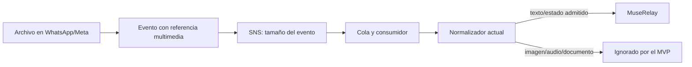

# Multimedia, tamaños SNS y alcance real del Bridge

Revisión documental del **25/10/2026, Europe/Paris**, a partir del texto aportado por el usuario y del código existente. No se desarrolló multimedia, no se modificaron límites/plantillas, no se consultaron mensajes ni se hicieron llamadas AWS autenticadas. Esta guía complementa [el onboarding](AWS-WHATSAPP-ONBOARDING.md).

## Registrar el número no crea una bandeja de atención

AWS Social proporciona transporte/API y eventos; el registro del teléfono no instala por sí solo la bandeja, organizaciones, agentes y herramientas de MuseRelay. El Bridge conecta esos eventos con el contexto empresarial y devuelve comandos de respuesta al transporte. Su valor propuesto consiste en integrar esas comunicaciones en los paneles habituales; no demuestra todavía un servicio comercial de onboarding de terceros.

Para recibir mensajes hace falta destino de eventos habilitado y suscripción/consumidor configurados. El texto recibido describe desmarcar «Publicación de mensajes y eventos» y una advertencia de que no se recibirán mensajes. Se registra como **estado comunicado**, no lectura API ni nueva captura inspeccionada. El arquitecto no cambió ese interruptor.

Si la consola permite terminar el alta con publicación apagada, ese resultado solo completa la etapa de registro que confirme AWS: **no convierte al canal en bidireccional**. Comprobar después el estado de vinculación y destino antes de cualquier ensayo. No prometer recuperación automática de mensajes enviados durante el intervalo sin destino/consumidor ni tratar una suscripción posterior como replay del pasado. No se ha confirmado aquí que el usuario pulsara el botón final de alta.

Fuente: [AWS Social: recepción de mensajes y destino habilitado](https://docs.aws.amazon.com/social-messaging/latest/userguide/whatsapp-receive-message.html).

## Archivo multimedia y evento técnico son objetos diferentes

Una imagen puede viajar por WhatsApp como archivo permitido por sus propios límites, mientras el evento de entrada contiene un ID de medio, tipo y metadatos. El tamaño de ese evento no tiene por qué coincidir con el archivo original. No insertar el archivo completo en base64 dentro de SNS para este diseño.

SNS **no comprime, redimensiona ni divide automáticamente un evento** para hacerlo caber en el límite del tema. Ese límite tampoco configura la compresión del archivo en WhatsApp. El tratamiento que pueda realizar la aplicación del remitente/Meta corresponde a sus propias reglas; no se ha verificado para la demo. Que SNS acepte un evento multimedia no significa que este Bridge descargue o muestre el archivo.

AWS ofrece [GetWhatsAppMessageMedia](https://docs.aws.amazon.com/social-messaging/latest/APIReference/API_GetWhatsAppMessageMedia.html) para recuperar un medio a S3 o consultar metadatos. Es una operación separada de la recepción de la referencia. No se ha llamado aquí a esa API. [Ejemplo oficial de recepción](https://docs.aws.amazon.com/social-messaging/latest/userguide/whatsapp-receive-message.html).

## Qué limita Maximum message size

Es el límite del mensaje publicado en el tema SNS: cuerpo **más atributos**, medidos en bytes. No es el tamaño máximo de adjunto visible en la bandeja MuseRelay.

| Unidad | Equivalencia |
| --- | --- |
| 256 KiB | 262.144 bytes |
| 1 MiB / 1.024 KiB | 1.048.576 bytes |

El soporte de 1 MiB se anunció el **18/09/2026**. Para configurar más de 256 KiB, SNS limita el tema a un máximo de 100 suscripciones y protocolos SQS, Lambda o Data Firehose. Esto no cambia la elección de **Standard**, porque Social no admite SNS FIFO.

Se puede actualizar el atributo de un tema existente, bajo autorización y respetando las condiciones de suscripción. Eso no amplía los límites de nuestro consumidor. El atributo no está configurado explícitamente en nuestras plantillas; se prepara el valor predeterminado de 256 KiB.

Fuentes: [anuncio oficial AWS](https://aws.amazon.com/about-aws/whats-new/2026/09/amazon-sns-1mib-support/), [publicación de mensajes grandes](https://docs.aws.amazon.com/sns/latest/dg/large-message-payloads.html), [SetTopicAttributes](https://docs.aws.amazon.com/sns/latest/api/API_SetTopicAttributes.html), [restricción FIFO de Social](https://docs.aws.amazon.com/social-messaging/latest/userguide/managing-event-destinations-add.html).

## Qué ocurre si se supera el límite

SNS rechaza `Publish` con `InvalidParameter` si cuerpo y atributos exceden el máximo configurado; no reduce el contenido para aceptarlo. El error se devuelve al publicador, que en este flujo es el servicio Social, **no necesariamente al teléfono del cliente**. No garantizar una notificación visible en WhatsApp ni un reintento/recuperación automático sin comprobar el comportamiento real del proveedor.

Ejemplos únicamente del control de tamaño SNS, suponiendo los demás requisitos satisfechos:

| Situación | SNS | Bridge actual |
| --- | --- | --- |
| Archivo multimedia permitido por WhatsApp de varios MB; evento con referencia de pocos KiB | Su archivo original no determina el tamaño publicado en SNS. | El evento multimedia se ignora; no aparece un adjunto por esta ruta. |
| Evento y atributos de 100 KiB; tema de 256 KiB | Cabe por tamaño. | Depende de formato, identidad, tipo y controles propios. No se certifica el flujo solo por este tamaño. |
| Evento y atributos de 300 KiB; tema de 256 KiB | Publicación rechazada. | No recibe esa publicación SNS. |
| Evento y atributos de 300 KiB; tema de 1.024 KiB con suscripciones compatibles | Cabe por tamaño. | El consumidor actual rechaza un cuerpo SQS de ese tamaño; ampliar SNS no basta. |

El límite se aplica también a publicaciones de texto/metadatos extensos o eventos agrupados. Mantener 256 KiB es la decisión inicial de configuración, **no una garantía de que todos los eventos posibles de AWS Social puedan procesarse**. [Contrato de Publish](https://docs.aws.amazon.com/sns/latest/api/API_Publish.html).

## Comprobación del código: multimedia no implementada

| Parte | Evidencia de código y comportamiento actual |
| --- | --- |
| Entrada normalizada | [normalize.ts](../src/normalize.ts): `if (msg.type !== 'text') continue`. Omite mensajes de imagen, audio, documento, vídeo y otros tipos. No conserva su referencia como un mensaje/adjunto nativo. |
| Estados | El mismo archivo admite `sent`, `delivered`, `read`, `failed`; no implica cobertura de todos los eventos Social. |
| Salida AWS | [social.ts](../src/social.ts) construye `type:'text'`. No construye envíos multimedia. |
| Recuperación de archivos | No hay llamada de descarga `GetWhatsAppMessageMedia` ni integración con almacenamiento de adjuntos para este transporte. |
| Permisos | [template.yaml](../template.yaml): el emisor recibe `SendWhatsAppMessage`; no se concede permiso multimedia ni se aprovisiona un bucket de medios. El bucket de artefactos de despliegue no es un almacén multimedia. |
| Prueba existente | [bridge.test.ts](../test/bridge.test.ts) contiene `MVP ignores media and users outside its explicit allowlist` y espera cero eventos para una imagen. Es evidencia de una omisión deliberada, no de soporte multimedia. |
| Otros canales MuseRelay | La capacidad multimedia de un transporte Meta directo existente no se hereda automáticamente por AWS. No se modifica ese transporte en esta revisión. |

Corrección a la explicación recibida: no basta con decir «multimedia pendiente de pruebas reales». **La implementación multimedia del Bridge está pendiente de desarrollar.** No afirmar que se descarga después, se conserva para reproceso o se avisa al cliente: esos mecanismos no están implementados. Un evento solo multimedia puede completar su procesamiento de cola sin generar un mensaje nativo; no presentar esa ausencia como un error que necesariamente acabará en la DLQ.

## Límites actuales dentro del Bridge

| Capa | Control existente |
| --- | --- |
| Cuerpo SQS entregado al handler | [handlers.ts](../src/handlers.ts): rechaza más de **250.000 bytes** con `Buffer.byteLength`. Incluye el sobre SNS recibido, no solo su campo `Message`. |
| Cadena `sns.Message` | [normalize.ts](../src/normalize.ts): hasta **240.000 unidades de cadena JavaScript**, según `string()` en [contracts.ts](../src/contracts.ts). No confundir este contador con bytes UTF-8. |
| Texto | Validación de hasta 4.096 unidades de cadena JS en Node y control de longitud en PHP; no son un límite de tamaño de archivo ni una promesa sobre Unicode/serialización completa. |
| Callback firmado a Core | [Controller.php](../integration/muserelay/src/Core/Controller.php): máximo **20.000 bytes** de cuerpo JSON con `strlen`, antes de aceptar/persistir. |
| Envío de texto nativo | [Outbox.php](../integration/muserelay/src/Core/Outbox.php) / [Protocol.php](../integration/muserelay/src/Core/Protocol.php): controles de texto de 4.096 con `mb_strlen`. |

Los contadores miden objetos diferentes; JSON, escapes, firmas de protocolo/metadatos y codificación pueden cambiar el tamaño efectivo. Incluso bajo 256 KiB SNS puede haber rechazos posteriores. Antes de ampliar a 1 MiB habría que revisar contrato completo, tamaños de sobre, memoria/timeouts, costes, pruebas de límites y manejo de mensajes no compatibles. No se hace esa ampliación ahora.

## Qué faltaría para un soporte multimedia comercial

Diseño futuro, fuera del alcance del primer ensayo de texto:

1. Ampliar contratos y recepción para representar un adjunto y su estado pendiente/fallido en la conversación, preservando identidad/organización y deduplicación. Definir una respuesta comprensible ante un tipo no soportado; hoy no existe.
2. Usar el ID de medio y el teléfono AWS correctos; consultar metadatos/recuperar con la API Social compatible. `GetWhatsAppMessageMedia` contempla destino S3 o URL prefirmada de destino, no ambos. Validar permisos, bucket/prefijo privado y cifrado elegidos; no reutilizar credenciales Meta directas ni registrar URLs firmadas.
3. Aplicar límites por tipo/tamaño, verificar MIME/contenido, tratar caducidad y errores, almacenar con aislamiento y controles de retención/borrado, y asociar el adjunto a la conversación nativa. Definir seguridad de archivos antes de mostrarlos/procesarlos.
4. Añadir la presentación en bandeja y el envío multimedia si se decide ofrecerlo; documentar qué agentes/modelos admiten visión, audio o documentos. Recibir un archivo no significa que el agente actual pueda interpretarlo.
5. Probar imagen/audio/documento, archivos inválidos/grandes, duplicados, permisos y aislamiento con datos de ensayo. Después una prueba real expresamente autorizada y con coste estimado. Revisar coste y cuotas de recuperación, S3, procesamiento e inferencia por separado.

No se añade una nueva funcionalidad o permiso como parte de esta guía. La primera demo sigue siendo **texto → agente Bedrock → confirmación → ticket nativo → respuesta**, pendiente de ejecución real autorizada. [Referencia de recuperación](https://docs.aws.amazon.com/social-messaging/latest/APIReference/API_GetWhatsAppMessageMedia.html).

## Registro de esta revisión

- Material recibido: explicación sobre registro versus recepción; descripción de un interruptor de eventos desactivado; texto de ayuda de SNS sobre 256 KiB/1 MiB; pregunta sobre compresión y multimedia.
- Conclusiones verificadas documentalmente: el tamaño SNS es el de la publicación; no hay compresión automática para hacerlo caber; límites grandes tienen condiciones; Social exige destino habilitado para recepción.
- Conclusiones verificadas en código local: texto y cuatro estados; multimedia omitida; controles propios más pequeños que el máximo SNS. No se ejecutaron pruebas nuevas ni se modificó implementación, porque la tarea consiste en documentar el comportamiento ya explícito.
- Estado externo: sin lectura AWS independiente, sin confirmación de finalización del alta o creación SNS y sin ensayo multimedia real. Una descripción pegada de otra conversación no sustituye una captura o respuesta AWS observada.
- Estado operativo: ninguna creación/activación, cambio IAM/KMS, despliegue, descarga de medios, envío o modificación de producción por esta revisión.
